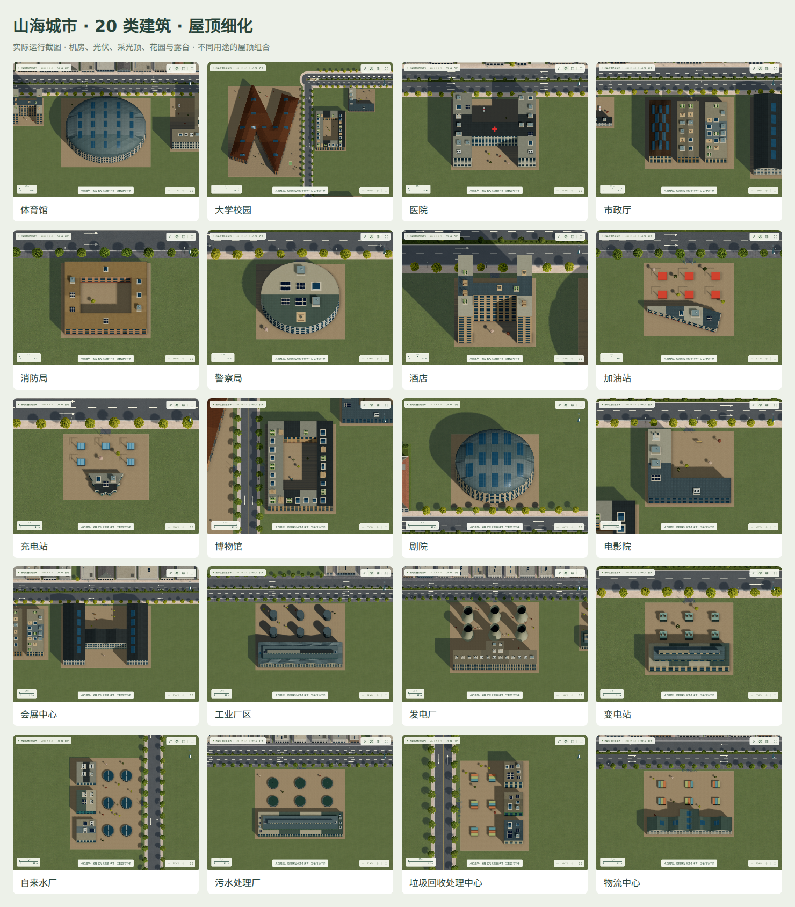
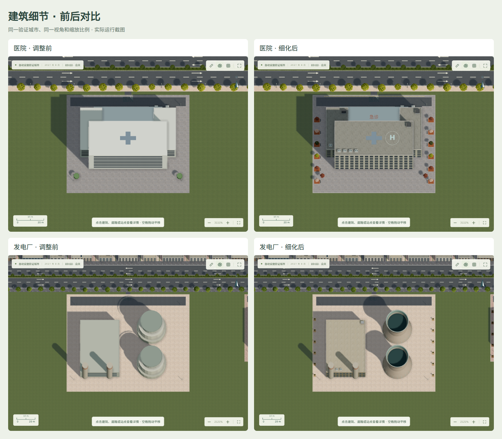
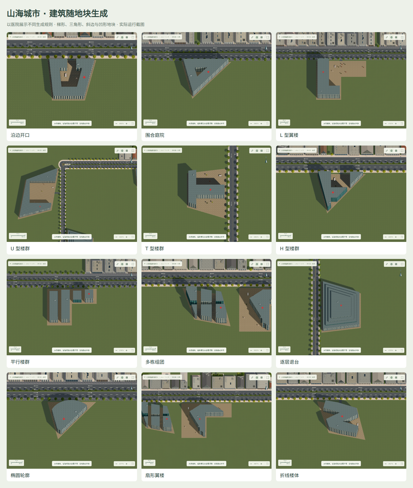
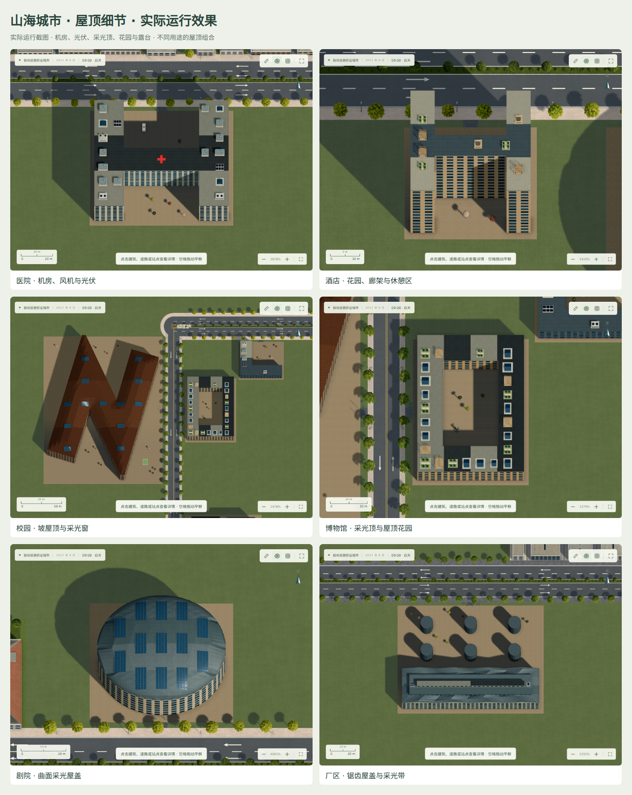

# 自动城市设施

新增 20 类自动设施。开启自动生长后，推进月份即可触发；无需手动放置，旧存档同样适用。

## 生成规则

以下为人口达标、存在合适空地且预算充足时的月度基础概率。人口缺口与生长速度参与倍率。每月最多新增 3 处，并受最大项目数限制。大型设施需要完整连续空地；没有合适位置时等待后续月份。

| 建筑 | 起始人口 | 每多少人口配置一处 | 月基础概率 | 同类间距 | 选址 |
|---|---:|---:|---:|---:|---|
| 体育馆 | 1,800 | 14,000 | 16% | 1100 m | 居住与商业片区周边，优先交通便利的大块空地 |
| 大学校园 | 4,000 | 30,000 | 10% | 1800 m | 城市边缘完整校园用地，避开密集楼群和污染设施 |
| 医院 | 900 | 6,500 | 35% | 650 m | 优先住宅服务空白，避开污染设施 |
| 市政厅 | 1,500 | 全城最多一处 | 16% | 2200 m | 城市中心活动区，全城最多一处 |
| 消防局 | 350 | 4,500 | 42% | 550 m | 面向居住与工业片区，接入普通路或主干道 |
| 警察局 | 350 | 4,500 | 40% | 550 m | 优先住宅服务空白，避开污染设施 |
| 酒店 | 700 | 4,500 | 30% | 360 m | 商务活动区或机场、车站等交通节点附近 |
| 加油站 | 300 | 4,000 | 35% | 650 m | 普通路或主干道沿线，远离学校和医院 |
| 充电站 | 200 | 2,500 | 48% | 350 m | 建成区道路沿线，避开污染设施 |
| 博物馆 | 2,200 | 20,000 | 13% | 1300 m | 商业与居住活动区，优先公共交通附近 |
| 剧院 | 1,800 | 14,000 | 17% | 900 m | 商业与居住活动区，优先公共交通附近 |
| 电影院 | 650 | 5,000 | 32% | 450 m | 成熟商业与办公片区 |
| 会展中心 | 3,500 | 25,000 | 12% | 1800 m | 成熟商务片区的大块空地 |
| 工业厂区 | 600 | 10,000 | 25% | 650 m | 工业仓储集聚区，优先货运节点 |
| 发电厂 | 1,800 | 24,000 | 18% | 1600 m | 工业边缘，远离住宅、学校与医院 |
| 变电站 | 300 | 6,000 | 35% | 600 m | 建成区或工业区周边 |
| 自来水厂 | 900 | 15,000 | 25% | 1000 m | 较低密度城市边缘，避开工业与污染设施 |
| 污水处理厂 | 1,200 | 16,000 | 23% | 1200 m | 工业边缘，远离住宅、学校与医院 |
| 垃圾回收处理中心 | 600 | 10,000 | 30% | 850 m | 工业边缘，远离住宅、学校与医院 |
| 物流中心 | 700 | 9,000 | 28% | 700 m | 工业仓储集聚区，优先货运节点 |

这些数值为游戏校准。污染设施与住宅、学校、医院至少相隔 250 m；加油站与学校、医疗设施至少相隔 120 m。后续自动住宅、学校和诊所也遵守避让。

## 占地和存档

- 三种随机尺度，朝向随道路调整，按适宜程度加权随机选址。
- 不占用建筑、道路、公共空间、保护用地或更新地块，保留已有指定用途。
- 检查平缓陆地、边界和入口，预留相交地块，防止后续普通建筑穿入场地。
- 种子、月份与城市状态相同则结果可复现，同月不重抽。
- 建设费和维护费进入财政；支持保存、恢复、拆除和撤销。
- 医院接入就医出行；博物馆、剧院、电影院接入文化出行。

## 模型范围

本次实现建筑外观、随机选址、土地保留、道路接入、财政和上述服务出行。发电供水管网、污水处理流量、消防响应、警务、大学招生、酒店入住和车辆充电尚未建立独立运营模拟。

## 验证

后端检查全部类型的合法选址、隔离、预算、开关、月度钩子、确定性、数量、间距、存档与拆除撤销。前端检查 20 类模型的坐标、占地范围、形态与 WebGL 几何。

`experiments/auto-facilities-city.json` 为预置人口与产业分区的受控验证城市，种子为 `auto-facility-gallery-1`。人口 15,400，19 轮设施月度生成覆盖 20 类；不代表空城自然发展 19 个月即可达到这一规模。浏览器检查三维画面、医院检查面板、Canvas 回退与夜间效果，记录在 `experiments/auto-ui-evidence.json`。

核心实现：`city-planner/backend/city/auto_facilities.py`、`city-planner/renderer/civic-buildings.js`。测试：`city-planner/tests/test_auto_facilities.py`、`city-planner/tests/special-buildings.test.cjs`。

## 建筑细化第二版

针对模型过于简化的问题，20 类设施增加真实窗格、窗框、窗台、门厅、女儿墙、屋面分缝、排水、空调外机、屋顶出入口及场地绿化。立面色调现在与材质贴图共同渲染，屋顶单独使用材质，不再被单一颜色覆盖。夜间窗灯逐窗分布。

体育馆使用有结构分缝的连续椭圆屋盖与中央天窗；剧院采用弯曲金属壳体；发电厂冷却塔具有收腰外壁、内衬与下沉开口。校园补充屋顶面板、运动场标线与球门；消防车辆有梯架；加油与充电设施补充设备细节；工业与物流建筑补充天窗、月台、护柱和货车；处理池增加栏杆、检修桥、旋转设备与管道；变电站增加散热片、绝缘子和电缆。

新增 `renderer/civic-details.js`，三维与 Canvas 共用几何。保留建筑占地和全部生成规则。模型测试检查实际验证城市中的坐标、边界、确定性、树种与窗格，并限制细节数量。16 项前端检查和 2 项预览服务器检查通过。实际浏览器检查 20 类建筑、检查面板、Canvas 回退与夜景，无脚本错误。

医院和发电厂的前后对比使用相同验证存档、视角与缩放比例。

最新浏览器记录：`experiments/refined-facilities-ui.json`。

## 分类配色与建筑变体

20 类设施各有独立的外墙、次要面板、装饰色、屋顶和玻璃配色。立面分区与窗间板保留纹理，玻璃有稳定的明暗色差。医院的屋顶、入口和上层立面采用红色医疗十字。

每类设施有三种结构变体。医院为院落式、双塔式和非对称楼群；大学为分散院系、平行教学楼和围合校园；酒店为单塔、双塔和带侧翼楼体；市政厅为中央塔、双翼塔和圆形屋顶；体育馆改变长宽比例与屋盖曲率；剧院为三、四或五组曲面屋盖。其他设施改变附楼、楼层组合或屋顶轮廓。

自动选址的尺寸倍率为 0.78、0.90、1.00、1.12、1.25，扩大或缩小后的实际占地继续参与道路、地形、其他建筑和敏感用地校验。已有存档保留占地与变体编号，重新加载后样式稳定。

验证：300 种建筑类型、尺寸、造型组合均未越出各自地块；自动设施后端 6 项测试通过；20 类建筑实机截图无脚本错误，夜间与二维显示通过。截图对照中的同类建筑使用相同地块和缩放，以展示造型差异。

## 当前版本：Block 自适应程序化建筑

新生成的自动设施和导入的已有自动设施使用多边形建筑生成器，三款固定模板仅保留为旧数据的前端兼容路径。新设施保存独立 architectureSeed，楼体由街区轮廓、用途和种子共同决定，重新加载不会重新抽取外观。

选址先识别普通地面道路围合的 Block。较小街区可整体作为候选，大街区截取合理规模的一部分；候选地块扣除道路退界后，继续执行地形、建筑冲突、保护地、分区、污染距离与道路接入检查。未围合的道路使用沿路候选用地。不会为填满街区而拆除已有建筑。

12 种组合规则包括沿边开口、围合庭院、L、U、T、H、平行楼群、多栋组团、逐层退台、椭圆、扇形和折线。规则还组合连续变化的翼楼宽度、楼层、退台深度与分栋数，故最终外观不是固定的 12 个模型。不同设施只采用适合其用途的规则；体育馆与剧院使用穹顶或拱形屋盖，工业与会展建筑有锯齿屋顶，水厂、发电厂、变电站等在可用空地布置独立设备。

建筑轮廓与退台使用真实多边形求交。带孔屋顶采用约束三角剖分，避免凹形缺口和庭院被三角形填满。斜边窗户、夜间灯光、二维与三维显示共享同一几何。医院保留红色医疗十字，空余场地可容纳救护车、树木和配套设施。

验证包括 20 类设施、4 种不规则地块与 12 种规则的 960 个组合，以及种子稳定性、Block 退界、道路接入和存档恢复测试。20 类模型通过真实界面截图、夜间显示与二维回退检查。示例图使用受控验证用地展示不同规则，不代表同一城市发展阶段会自然生成所有示例。

## 屋顶结构与用途布局

屋顶按可用面积和建筑用途布置机房、风机冷水机组、排风管、倾斜光伏板、立体天窗、花园、廊架、休憩平台和满足空间条件的医院停机坪。窄翼楼使用紧凑模块。校园主楼可采用坡屋顶，曲面和锯齿屋盖的采光带沿实际曲面分段贴合。

每块屋顶具有确定的材质类别、图集变体、纹理角度、尺度与偏移；屋面采用连贯分区，替代统一的四米平铺纹理。医疗十字单独预留空间。所有模块须完整落在本层外露屋面内，避开庭院、上层退台、其他模块和标识。重新加载保持布局稳定。

屋面布局测试覆盖不同用途与三角、梯形、凹形、斜形地块，检查支撑范围、相互碰撞、上层覆盖、标识净空与种子稳定性；渲染验证包含昼夜和二维回退。

