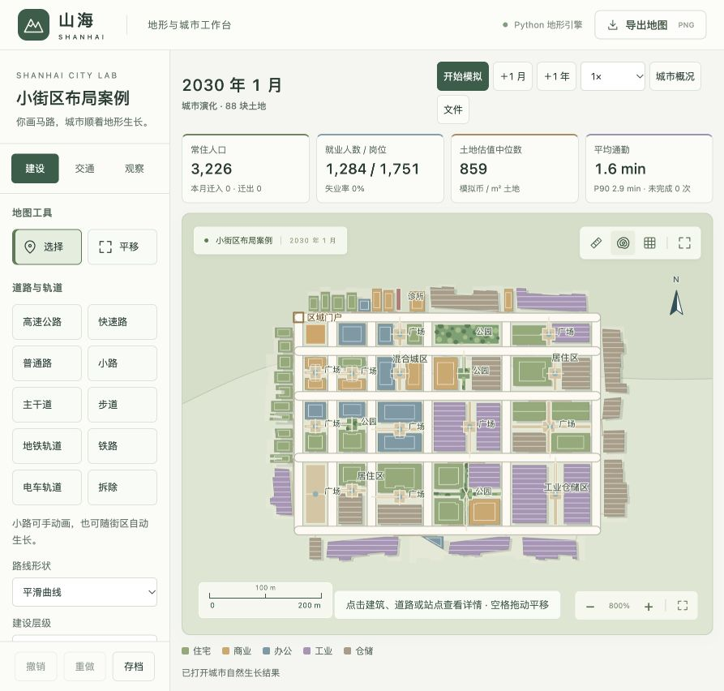
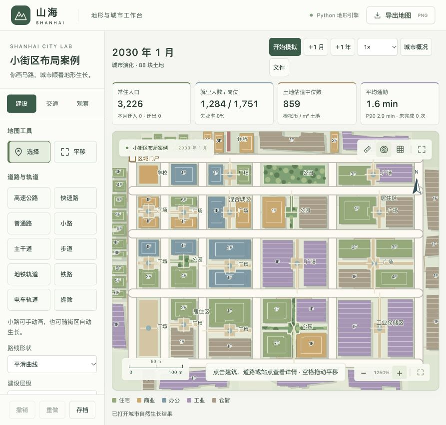
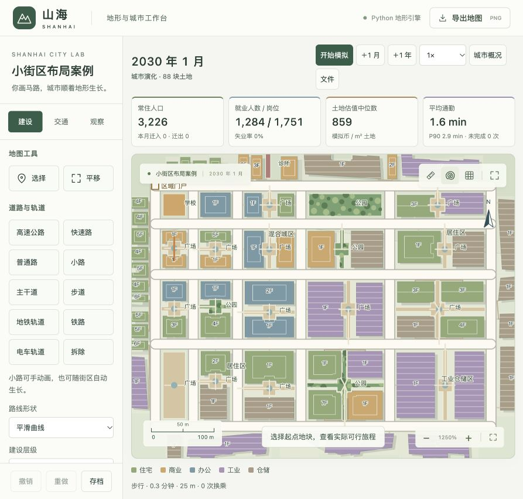

# v6 小街区整体布局与内部空间

这是历史版本记录；当前规则和案例入口已升级为 [v7 街区多样性](city-block-variety.md)。

模型 `shanhai-city-6`，校准 `urban-6`，日期 2026-10-21。

## 1 对“大块空地”的进一步诊断

v5 改善了沿街间距，但不能将内部空地只解释为“城市还没有成熟”。对第 96 月原始存档的只读检查发现：

- 地块生成仍以道路两侧的浅条带为主，街区中心未被分配为建筑候选地。
- 内部补路与向外扩张共用 52% 的开发面积门槛。距离经济核心约 191 m 的内部支路，附近 22 块土地有 8 块已占用，面积比例 45.1%，仍不能建设；其后续分支也须等待父路。
- 住宅开发用全城缺口比例控制：第 96 月住房空置为 0、待安置家庭需求为 169 户，但计入在建和扩建容量后的缺口比例为 7.91%，低于继续追加项目所需的 8%。这不等于没有真实需求。
- 所查核心附近约 59,670 m² 街区内还有 19 块已接路空地，坡度中位数 0.44%。逐块按现有住宅轮廓与收益公式计算，19 块都能形成合法轮廓且通过收益门槛。因此该处空地不能笼统归因于山坡或开发不赚钱。

## 2 小街区的三种布局

在道路围合、地形可建、尚无既有建筑或保护用地的小街区，先分配整个可用地面，再让建筑和配套随需求生长。当前整体规划上限默认 22,000 m²，并且不超过自动支路的目标街区面积。更大街区先补充道路，再在适合的空白小街区应用布局。

| 布局 | 建筑与公共空间 |
| --- | --- |
| 整街区用地 | 一块完整用地，可形成一栋大型建筑；公共配套有需求时也可选为整体公园或广场。保留必要边界退让。 |
| 双建筑院落 | 两块独立建筑用地，中间预留连通小路和加宽的共享院落。两栋建筑可以分期建设。 |
| 多建筑院落 | 四块不同面积的建筑用地，围绕共享通道和中心空间布置，随需求逐步开发。 |

划分遵循真实街区边界，面积不重叠，建筑用地和共享空间共同覆盖可用土地。道路路幅先扣除；曲线、斜边和地形不允许套入合法布局时保留原沿街开发方式，不强行覆盖。已经存在建筑、公共设施或明确用途偏好的地块不会为了换布局被自动搬走或拆除。

建筑占地由布局决定，整街区建筑不再套用普通小塔楼的 520 m² 标准层上限。大项目仍必须满足实际需求和收益，先以需求支持的层数开发，后续可以加层；未施工地块不能虚构人口或岗位。

## 3 剩余空间是真实对象

共享用地从地块划分时就预留，避免以后被建筑挤掉。街区出现首栋建筑后，系统按预算启用共享小路、院落广场或口袋公园。其面积、服务容量、建设支出和维护费用都来自真实对象。共享空间不会被普通住宅或仓储项目吞并，也不替代全城公园、学校和诊所的服务配置。

建筑可拥有朝向院落的步行入口，与公共空间形成真实图边；共享空间通过预留通道接回街道。检查连线必须位于该建筑用地与共享空间内，不能穿其他建筑或水体。公共设施通过自己地块的接入口访问，避免直接向最近道路连线时穿过邻楼。

界面显示「整街区用地」「双建筑院落」「多建筑院落」、街区已建数量与建筑用地数量；共享空间显示规划用途。公园按其实际范围绘制树木，院内步道绘制在开放空间上。小路仍支持手绘与自动生成。

## 4 内部补路和需求修正

开放道路向外延伸仍采用默认 52% 开发面积门槛；闭合街区内部细分改用独立的默认 28% 门槛，保留至少 3 栋邻近建筑、父路顺序、地形、冲突和预算检查。初始空城仍仅允许有限冷启动连接，不能无需求铺满地图。

新开发允许由实际住房或岗位缺口触发，默认缺口达到 8 个单位即可参与竞争，不再要求所有规模城市一律达到全城 8% 才能追加。百分比需求、项目容量、在建供应、收益与用途偏好仍同时生效。大型建筑需要足够需求，不以填满地图为理由强制建造。

## 5 验证与查看

新增回归覆盖：不规则街区的土地划分和不重叠、道路生成布局与重复重建稳定、整街区建筑和公园/广场、双建筑共享通路及存档、既有建筑保留、低于 8% 但有实际缺口时仍开发。

专用自然案例只预设 20 个不同面积的道路围合街区和区域需求，从空地运行 48 月，没有手放建筑或指定每栋用途。首页「复杂路网案例」中选择「查看小街区布局案例」查看；「从小街区路网开始」可重跑。它用于验证小街区布局，不替代双岸河谷的长期交通与城市形态对照。

旧存档迁移保留已有建筑和校准值，空白小街区在后续道路重算时可采用新布局；不会自动拆除旧建筑重排。不同街区可处在不同开发阶段，共享空间预留并不意味着所有建筑已经完工。

## 6 本轮实际结果

完成代码与测试编辑、自查后，一次集中 `npm run test:city`：69 项 Python、9 项 JavaScript 几何与前端/Electron 语法全部通过。没有反复运行无关地形全集。日志见 [集中回归](experiments/city-v6-regression.log)。

只铺道路的自然案例运行 48 月，人口 3,226、建筑 68 栋、20 个闭合小街区：

| 布局 | 数量与实际状态 |
| --- | --- |
| 单一用地 | 4 块：1 栋占地 1,804 m² 的办公楼、1 个整体公园、1 个整体广场、1 所学校 |
| 双建筑院落 | 14 块，每块两栋建筑与共享空间均出现 |
| 多建筑院落 | 2 块，每块四栋建筑与共享空间均出现 |

建筑实际占地范围约 349–6,171 m²。16 个共享院落具有 36 个朝内建筑入口和 16 段接街路径；没有缺少院落入口的成组建筑。街区内土地划分面积差为 0 m²（保留六位小数），路径穿建筑为 0，建筑重叠、占路、侵水/不满足可建地形、断连均为 0。

界面实际查询双建筑院落中的两栋商铺：步行 25 m、0.3 分钟、0 次换乘，路线穿过中间共享空间。详情正确显示「双建筑院落」「2 / 2」；控制台没有记录错误。







原始资料：[自然生长与土地/通路检查](experiments/blocks-v6-final.json)、[完整存档](experiments/blocks-v6-final.json.gz)、[生长日志](experiments/blocks-v6-growth.log)、[界面详情](images/blocks-v6-details.png)。复现命令：

```sh
npm run test:city
.venv/bin/python scripts/grow_blocks.py
```

此案例验证规则能够自然产生用户提出的布局；它没有设置公共交通线路，也没有证明复杂大城市在新规则下已经完成长期形态与性能验收。当前布局为一、二、四个建筑用地方案，尚未实现任意数量建筑的自由重新组合或对有人居住的旧街区自动拆迁改造。
