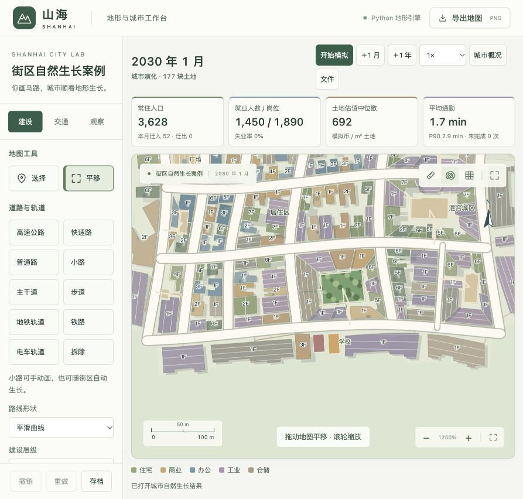
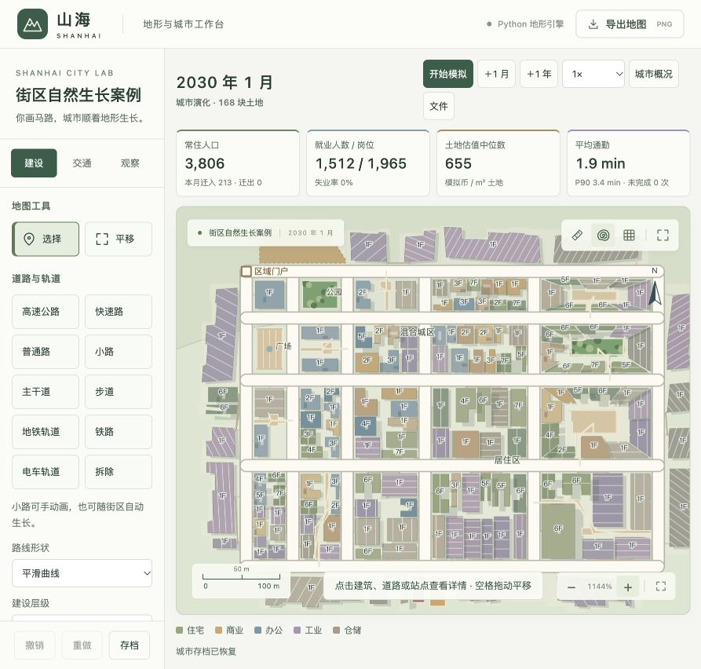
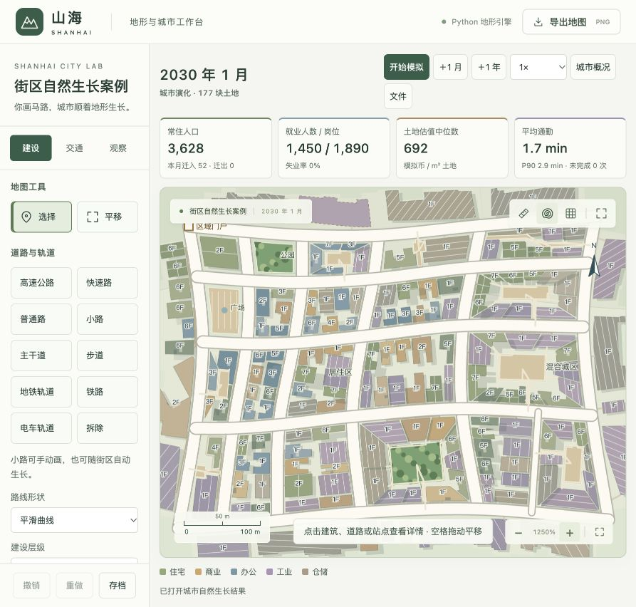
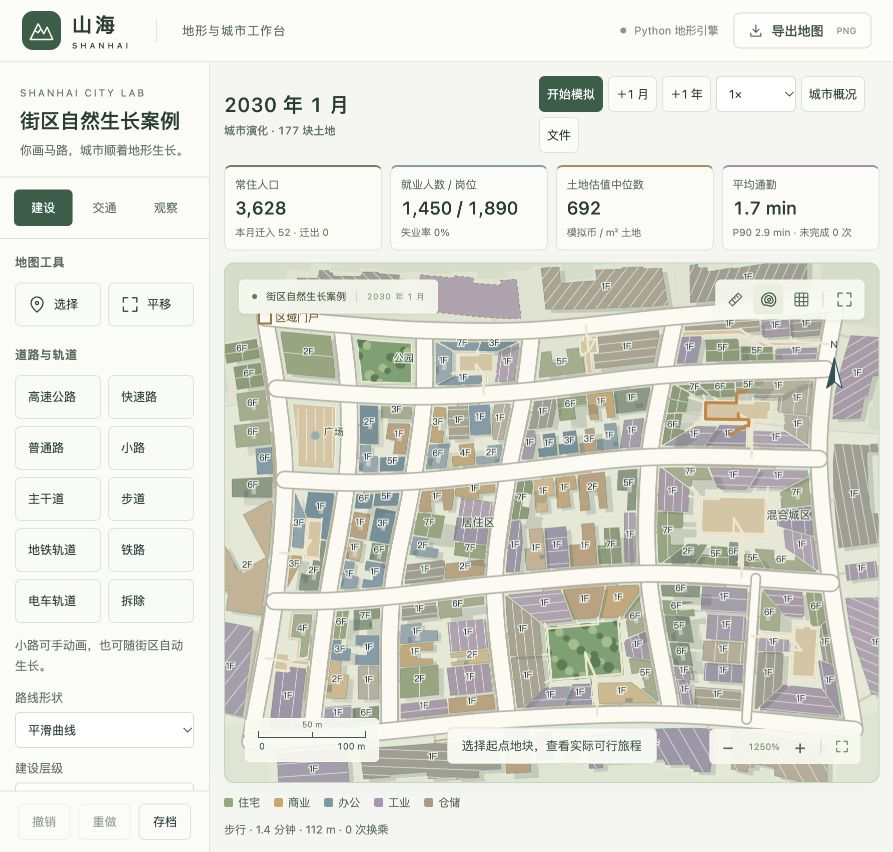

# v7 街区形态与建筑多样性

本轮修正 v6 的重复双栋、四栋和十字广场。目标是在保持土地守恒、真实交通和按需开发的前提下，使相同道路网也能产生尺度不同的建筑与空间。模型为 `shanhai-city-7`，校准为 `urban-7`。

后续 v8 已修正本文案例中独立厂房和仓库的台阶状外轮廓，并更新首页小街区案例；以下 v7 数值和截图保留作历史对照。详见 [工业建筑轮廓修正](city-industrial-footprints.md)。

## 规则

- 少量小街区仍可整体用于建筑、公园、广场或配套。
- 连续沿街地块按街边长度和不等宽权重划分，前后排深度不同，不强制设置公共广场。
- 围合庭院留出偏心内院和窄入口，四边分别切分；建筑数量由边长与有效地块面积决定。
- 巷道街区围绕折转的窄巷划分两侧地块，局部加宽，不使用固定十字中心。
- 侧园组团把绿地放在街区一侧，以较大、较浅覆盖的建筑用地连接绿地。

形态选择考虑实际面积、坡度、景观、主街邻接和连续空间尺度，并以街区边界作稳定种子。随机变化不改变重建和存档后的形状，也不会每个月重抽。当前不涉及既有居民街区拆迁或任意形状的全局最优装箱。

## 建筑与公共空间

建筑沿实际街道切线朝向，轮廓由真实用地裁切。沿街地块保持较小侧向退让，住宅、商铺、办公和工业使用不同覆盖规则；部分建筑带侧翼或开口内院。非整块办公项目保留较小标准层，使需求能支持不同楼高，而不是全部铺成一层大板。楼层、面积、容量和费用仍由同一真实轮廓计算。

不同屋面细节与同用途的小幅色差辅助阅读地图。屋顶设备仅为绘制细节，不代表额外人口、岗位或楼层。共享院落不再统一绘制喷泉，也降低小院落文字的显示频率；完整公园、广场和公共服务仍明确标注。

### 合并地块的工业屋面朝向修正

厂房、仓库合并多块沿街用地后，地块中心会变化，但旧入口仍被保留。此前绘图使用入口到新中心的方向推算屋顶朝向，导致曲线案例南侧两栋建筑的条纹偏转约 60°，而真实楼体长轴约为 0.9°、11.4°。现在屋面条纹按建筑实际轮廓的最小面积包围矩形长轴对齐，结果按轮廓缓存；旧存档重新显示即可生效，不改变用地、建筑面积或模拟容量。

合并后轮廓下沿的台阶来自沿街地块的合并与裁切；v7 的这次修正仅处理屋面方向，后续 v8 才修改了独立厂房、仓库的主体轮廓，见上方链接。针对台阶状轮廓的平移、旋转、顶点顺序与退化输入进行了几何检查：`node --test tests/city-geometry.test.cjs` 的 3 项测试通过，两个修改的前端脚本通过语法检查。同一案例实际界面复查时无控制台错误。



## 通路与兼容

折转小巷和凹形庭院采用多边形内可视路径，不能直接穿越邻楼。围合庭院优先沿内院边缘绕行，再通过短支路接门，避免每栋建筑都向中心拉一条放射线。建筑到院落、院落到街道的路径长度进入真实步行图，统计不能用穿地块的直线捷径代替。纯沿街街区不要求内部公共通路；每栋仍需合法临街接入。道路、建筑不变时缓存内部通路；新建筑出现后只为变化的建筑计算路径，复用路径仍须对全部实际建筑进行碰撞检查。

保留 v1–v6 存档的既有街区、建筑和校准值；新布局应用到新规划的空白街区。默认示例改为曲线小街区，同时保留与 v6 相同的规则路网对照。两个案例都只预设道路与区域需求，运行 48 月，不手放建筑和用途。

## 验证

回归覆盖不规则土地划分、不同建筑数量与面积、折转通路长度、曲线街区入口、建筑避让、重建一致性和 v6 存档迁移。首轮 74 项城市回归暴露曲边几何问题；修复后按影响范围复查 18 项地块/道路/街区回归，全部通过，9 项 JavaScript 几何及前端/Electron 语法检查通过。最后的庭院沿边路径调整另外复查 2 项通路与恢复检查，通过。没有因迭代反复运行无关地形全集。

修复包括曲边旋转的浮点自交、庭院角部用地接入、过窄残片合并，以及近重合边界合并时错误丢失预留面的情况。后者通过 0.0000001 m 的几何合并精度处理，并检查所有独立生成的沿街地块不能侵占整个街区的预留地。

日志：[首次城市回归](experiments/city-v7-regression.log)、[修复后的相关复查](experiments/city-v7-geometry-recheck.log)、[庭院路径复查](experiments/city-v7-courtyard-recheck.log)。

当前脚本使用 v8 生成规则，并写入独立的 v8 文件；以上 v7 日志和存档保持不变。运行命令：

```sh
npm run test:city
.venv/bin/python scripts/grow_blocks.py --regular
.venv/bin/python scripts/grow_blocks.py
```

## 自然生长与界面结果

两个案例均从空路网自然运行 48 月。规则路网与 v6 使用同一组道路、同样的区域需求和生长设置，变化来自新模型的土地划分、建筑与步行规则；曲线案例额外检验不规则边界。没有手放建筑或指定每栋用途。

| 指标 | v6 规则路网 | v7 相同规则路网 | v7 曲线路网 |
| --- | ---: | ---: | ---: |
| 人口 | 3,226 | 3,806 | 3,628 |
| 建筑 | 68 | 156 | 164 |
| 闭合小街区 | 20 | 20 | 21（生长中补路） |
| 共享院落数量 | 16 | 8 | 9 |
| 建筑重叠 / 占路 / 侵水 / 断连 | 0 / 0 / 0 / 0 | 0 / 0 / 0 / 0 | 0 / 0 / 0 / 0 |

规则路网中出现 1、2、7、8、9、11、12 块建筑用地的街区；曲线案例出现 1、2、4、5、7、8、9、10、11、13 块的街区。两案各有 9 个不设强制公共院落的连续沿街街区，也保留了整体公园与广场。曲线案例的实际建筑占地约 136–3,745 m²；当前这两个固定种子没有自然选中侧园方案，侧园的土地守恒与尺度变化由独立几何回归覆盖。

规则案例 49 个朝内入口、曲线案例 63 个朝内入口均有路径；各另有 8、9 条接街路径。没有缺少入口或路径穿越建筑，街区可用土地的未分配面积差保留六位小数为 0 m²。

界面实际显示「围合庭院」「11 / 11」，选中住宅的真实占地为 222 m²、5 层；跨院查询得到步行 112 m、1.4 分钟、0 次换乘，沿预留通路行走。浏览器未记录控制台错误。首页「复杂路网案例 → 查看小街区布局案例」打开曲线案例；从空白小街区入口可重新演化。

相同规则路网的实际截图：



曲线路网的实际截图：





原始数据：[规则路网报告](experiments/blocks-v7-regular.json)、[规则路网存档](experiments/blocks-v7-regular.json.gz)、[曲线报告](experiments/blocks-v7-final.json)、[曲线存档](experiments/blocks-v7-final.json.gz)、[建筑详情](images/blocks-v7-details.png)。

这是街区形态与几何通路的验收，不代表大城市/CBD、公共交通和长期性能已重新完整验收。新案例人口仍为数千人，未设置公交线路；建筑用途仍由现有交通、集聚与需求模型决定，新增形态规则没有虚构高楼或人为涂出用途分区。旧存档不会自动拆除已有模板街区。
