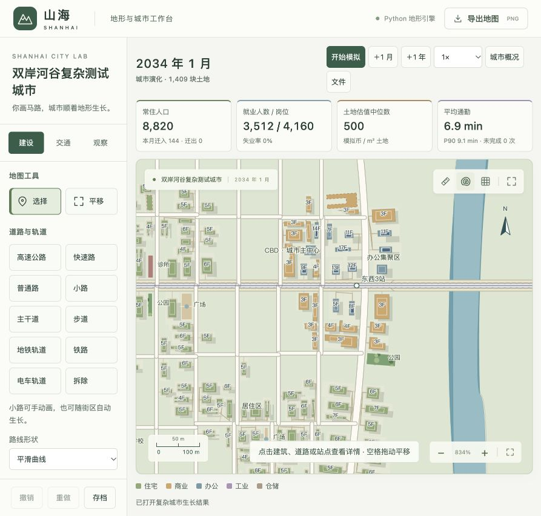
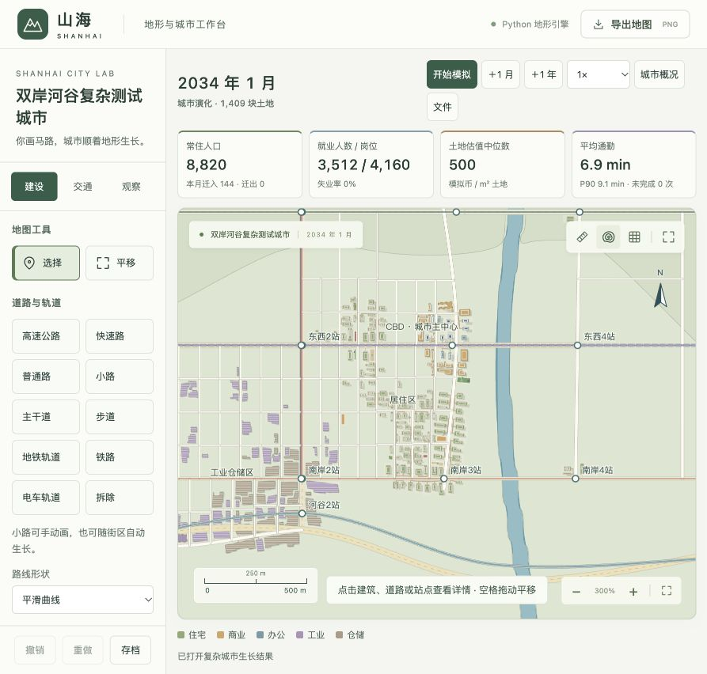
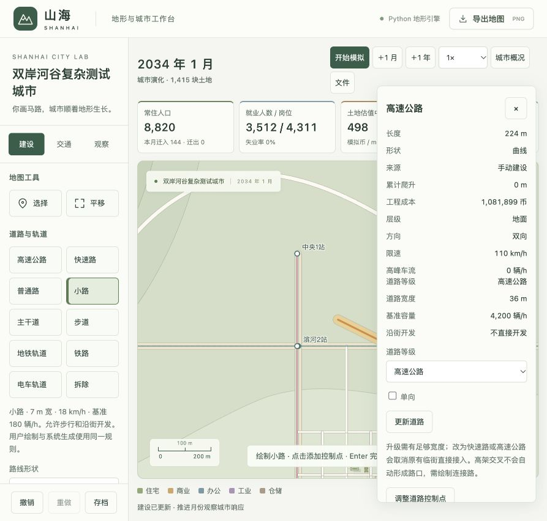

# v4 城区集聚、商务楼群与道路分级验证

> 历史记录：v4 改善用途集聚，但仍存在过大退界与空隙；后续 v5 原因分析、修正及同场景对照见 [连续街区验证](city-frontage-validation.md)。

日期：2026-10-21。模型 `shanhai-city-4`，校准 `urban-4`。本轮回应用户指出的办公楼零散、学校公园扎堆、片区不清晰，并加入可手绘、可改等级的高速公路、快速路、普通路和小路。

## 1 原图的问题

旧 v3 的 144 月存档共有 7 栋办公楼，只有 2 栋达到 10 层；办公建筑中仅 42.9% 的最近邻也是办公。6 处公园最近相距 36.4 m，6 所学校最近相距 96.0 m。虽然分类器给出了 CBD 标签，图面仍是较零散的办公和过密的公共配套，因此原验收对 CBD 形态的判断过于乐观。

用户所说的“区域应当成片”是本轮的设计目标：办公与就业形成核心，住宅形成连续邻里，工业仓储围绕货运集中，同时保留商业服务和片区边缘的混合。高楼数量必须有需求和实际入住支持，不能只把零散建筑画高。

## 2 具体算法调整

1. **分用途邻里亲和度**：根据真实已建、在建建筑及距离计算住宅、商业、办公和重工业邻里影响。住宅更偏好住宅邻里及生活环境，办公偏好商务核心及办公邻居，商业兼顾居民和中心，工业仓储仍受货运、坡度和地价约束。
2. **经济核心与路径依赖**：从实际道路中心性和运营公交机会选出持久的核心位置，旧档优先考虑现有办公。它只是选址吸引力，不产生人口或岗位、不直接等于 CBD。实际步行不通的地块不能获得核心加成。
3. **需求约束的建筑体量**：办公标准层上限随地块稳定变化，约 286–520 m²；住宅上限约 585–780 m²，实际面积可因地块限制而更小。办公首期开发受需求份额约束，避免单栋建筑吃掉后续多年需求；面积、容量、造价和可用空间使用同一真实轮廓。
4. **先评估扩建，再分配新项目**：旧顺序把需求先分给新地块，既有办公很难长高。现在已入住超过 70%、楼龄超过 36 月的建筑可以按剩余需求增建，每次至多 2 层、6 月后交付；在建加层计入未来供应，不能重复占用需求。目标高度随市场规模、核心距离、同类集聚和地形上限变化。
5. **严格识别 CBD**：新版默认需要至少 6 栋建筑，其中至少 5 栋办公楼各有 180 m 内的办公近邻，并满足 800 岗位、500 名实际办公商业就业者、办公面积份额和可达性条件，连续 3 月才成立。单栋办公楼、住宅高楼以及“核心位置”均不能代替这些条件。
6. **配套分服务范围**：按实际人口/岗位而非简单建筑数量生成设施，优先覆盖已有步行服务尚未覆盖的居民；同类公园、广场、学校、诊所默认最小间距为 240、260、480、650 m，非广场设施避让强办公核心。所有值均为游戏校准参数，不是现实规划标准。
7. **地图表达**：阴影随真实高度变化，高楼有屋顶核心与楼层标注；不修改建筑占地来伪造密度。低中层住宅、低层商业和办公高楼可在同一视图辨认。

## 3 固定路网从零自然生长

沿用双岸河谷的 6×6 km 地形、主路、桥梁、公交及区域铁路；不手放建筑，不指定用途分区或 CBD，不修改中途人口。设定：每月迁入参数 110、外部岗位需求 900、增长倍率 1.6、项目上限 18、自动生长开启、预算约束关闭、可达预算 30 分钟。

本次从第 0 月连续运行到第 96 月，月度记录均保存。旧 v3 对照为用户截图对应的第 144 月，两者**年龄和算法不同**，这里只对比问题是否得到修正，不作单一参数的因果实验。

| 指标 | 旧 v3 / 144 月 | 新 v4 / 96 月 |
| --- | ---: | ---: |
| 人口 | 10,736 | 8,820 |
| 建筑 | 148 | 240 |
| 办公楼 | 7 | 13 |
| ≥10 层办公楼 | 2 | 7 |
| 最大相邻高办公楼群 | 2 栋 | 7 栋 |
| 办公最近邻同类比例 | 42.9% | 76.9% |
| 办公同类最近邻平均距离 | 52.8 m | 38.3 m |
| 商业最近邻同类比例 | 37.5% | 80.0% |
| 住宅最近邻同类比例 | 85.1% | 99.2% |
| 公园数 / 最短间距 | 6 / 36.4 m | 3 / 519.5 m |
| 学校数 / 最短间距 | 6 / 96.0 m | 2 / 487.0 m |
| 诊所数 / 最短间距 | 4 / 100.1 m | 2 / 676.2 m |

“同类最近邻比例”按全部建筑中最近的建筑是否同类计算，并不要求把它最大化。工业与仓储是兼容混合的用地，不能因为仓库旁是工厂就判为不合理；商业仍可进入居住和办公片区。高办公楼群按 ≥10 层、180 m 邻近连通分组，是本实验的测量口径，不是法定高层建筑定义。

新版 13 栋办公楼均已竣工；其中一组相邻楼层为 **10、11、11、12、13、14、17 层**。住宅主要为 4–6 层，商业 3–4 层，工业仓储单层。自然识别的 CBD 单元包含 23 栋各类建筑、1,540 个岗位；它和周边办公商业片区共同形成图上的商务核心。





几何扫描：建筑互相重叠 **0**、侵入地面道路 **0**、不可建地形/水体侵入 **0**、无道路接入建筑 **0**。真实占地范围约 **133–8,402 m²**，共 **101 个闭合街区、96 条自动道路、449 条入口/院内/邻里路径**；5 条运营线路覆盖巴士、地铁、有轨电车与火车。平均通勤 **6.9 分钟**，3,512 户、3,512 名代表就业者、4,160 岗位。

本轮 96 月总计算耗时 902.59 秒、末月 18.066 秒、峰值内存 538.5 MiB。道路和地块增加使月度计算仍偏慢；本轮没有重新进行十万人口压力测试，不能沿用旧版性能指标作为新版保证。

## 4 道路分级与小路双来源

建设面板直接选择高速公路、快速路、普通路、小路，保留主干道和步道。小路可手绘，也可由系统生成；自动小路可以调整线形或等级，来源和父道路保持可追踪。

默认高速公路 / 快速路 / 普通路 / 小路分别为 **110 / 90 / 35 / 18 km/h**、**36 / 30 / 14 / 7 m** 宽、**4,200 / 3,200 / 600 / 180 辆/h** 基准容量。宽度、地形、建设费、维护费、拥堵和噪声参与正常模拟。高速/快速路不能步行、直接长沿街建筑或直接设公交站；车辆与公交可以通过，街区和车站由地方道路接入。

选中道路 →「道路等级」→「更新道路」。扩大路幅会检查建筑、公共空间和保护用地；失败完整回滚。升级为高速/快速路取消原有地块直接接入但保留旧建筑，不能留下可步行上高速的隐形连接。交叉仍使用同层路口、跨层端点的抽象模型；复杂互通立交尚不自动生成。

实际浏览器中已手绘一段 224 m 小路，再升级为高速公路，确认显示 36 m、110 km/h、4,200 辆/h 和禁止直接沿街开发；另选中自动生成的社区街，确认来源为“城市自动生成”、等级为“小路”，并可使用等级修改控件。浏览器无控制台错误。道路实操使用临时会话，未写入自然生长案例。



## 5 验证、复现与存档

完成生长算法编辑后集中运行 `npm run test:city`：55 项 Python、9 项 JavaScript 检查及脚本语法检查通过。随后用户追加道路分级需求，完成该部分编辑和自查后，集中运行 23 项受影响检查（含全部 v4、道路网络、四方式公交、曲线及地形），加 9 项 JavaScript 与前端语法检查，全部通过。

原始证据：

- [新版 96 月存档](experiments/valley-v4-final.json.gz)、[逐月与几何数据](experiments/valley-v4-final.json)、[新版形态测量](experiments/valley-v4-form.json)
- [旧版形态测量](experiments/valley-v3-form.json)、[旧版地图](images/valley-center.png)
- [生长算法回归日志](experiments/city-v4-regression.log)、[道路分级追加回归](experiments/city-v4-road-regression.log)
- [实现说明与道路规则](city-implementation.md)、[全部需求核对](requirements-audit.md)

在 `city-planner` 目录复现：

```sh
.venv/bin/python scripts/grow_valley.py --months 96 --output ../docs/experiments/valley-v4-replay
.venv/bin/python scripts/analyze_urban_form.py --snapshot ../docs/experiments/valley-v4-replay.json.gz --output ../docs/experiments/valley-v4-replay-form.json
```

首页 **复杂路网案例 → 打开已生长案例** 加载本轮存档；选择“从空路网开始”可以重新观察生长。旧存档迁移保留原有建筑和参数，不会自动挪动旧楼或合并学校，所以不能仅打开旧档就期待整个形态立即改变。

## 6 解释范围

本例说明同类用途能形成更连贯的片区，办公楼能形成有实际需求支持的高度群，公共配套不再连续挤在核心。8,820 人的游戏城市形成的是小城市商务核心，不能把它描述为大都会尺度的高密度 CBD；也不能用一次固定种子验证所有地形、路网和多中心形态。

核心位置采用简化的持久历史吸引点、设施采用人口配置及步行覆盖、建筑加层采用统一施工近似；还没有现实地价或楼宇数据标定。当前目标是结构更合理的城市生长游戏，不是现实城市预测。

设计参考：[世界银行《Pancakes to Pyramids》](https://www.worldbank.org/en/topic/urbandevelopment/publication/pancakes-to-pyramids)讨论经济增长、土地需求与城市向上增长的关系；[OECD《Demystifying compact urban growth》](https://www.oecd.org/en/publications/demystifying-compact-urban-growth_bbea8b78-en.html)讨论密度、集聚及混合用途。文中的具体距离、楼层和容量都是本项目参数，并非这些来源给出的标准。
