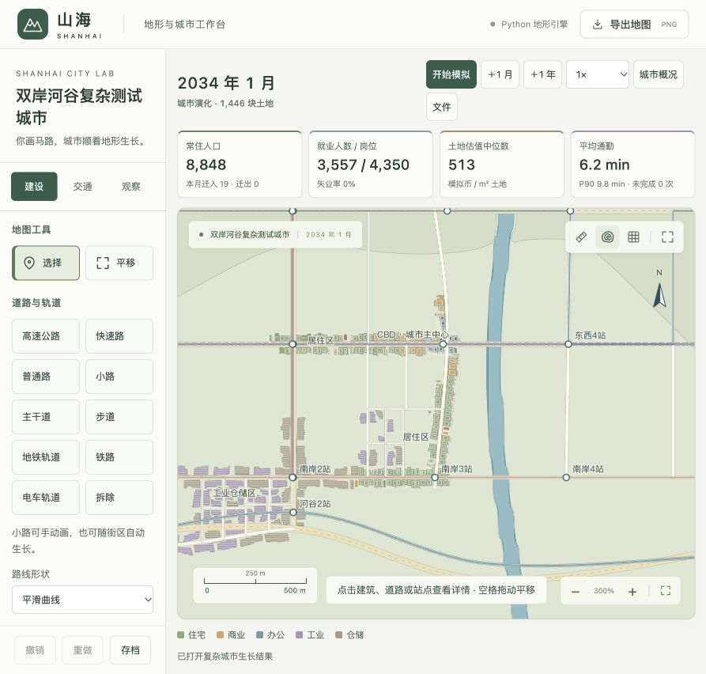
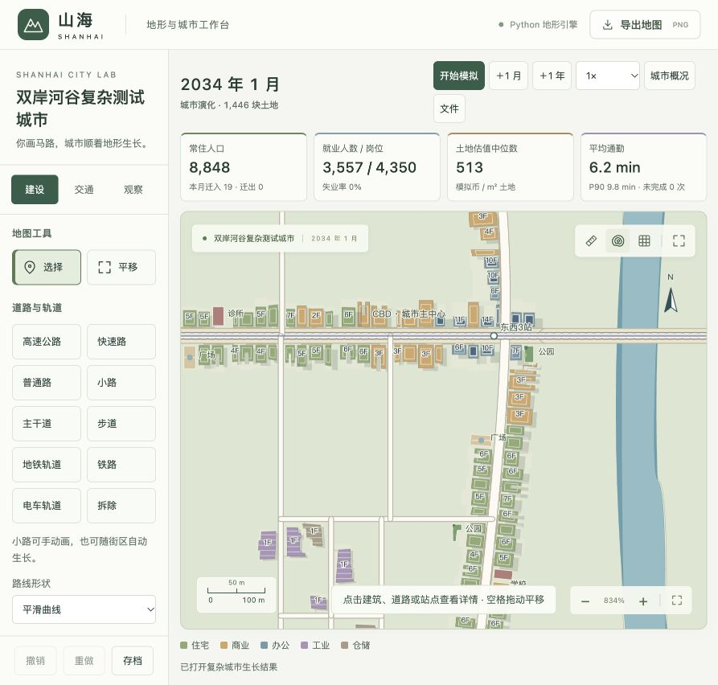

# v5 沿街连续性与空隙修正

> 历史记录：后续诊断发现内部补路与外扩共用门槛、全城百分比需求及沿街条带划地仍造成内部空地。v6 修正及小街区整体布局见 [新验证记录](city-block-layouts.md)。

日期：2026-10-21。模型 `shanhai-city-5`，校准 `urban-5`。

## 1 为什么旧地图仍然很空

v4 解决了部分同类用途聚集和 CBD 楼层问题，但它仍把楼宇当成散放在大地块中央的独立物体。真正的几何检查发现：

| v4 第 96 月 | 住宅 | 办公 | 商业 |
| --- | ---: | ---: | ---: |
| 建筑占地 / 所在地块面积中位数 | 27.7% | 20.4% | 52.3% |
| 建筑到临街接入点（路中）距离中位数 | 17.1 m | 27.3 m | 14.3 m |
| 同类最近建筑边缘间隙中位数 | 14.2 m | 20.5 m | 7.0 m |

这里的距离是**中位数**，且距离测量目标为地块在道路中心线上的临街接入点，包含半幅路宽，不能当作纯建筑退界；不规则地块还可能包含少量侧向偏移。旧案例有 1,409 块土地、240 栋建筑、96 条自动小路；核心 450 m 内有 180 块地，只有 80 块有建筑。问题来自三个相互叠加的规则：

1. 原地块进深偏大，建筑达到面积上限后又以质心等比缩小，四周都留下空隙。
2. 自动补路只需要附近少量建筑，就能继续切出新街区，早于已有临街土地填满。
3. 选址有“同类靠近”加分，但没有明确区分“填已有街道上的洞”和“继续向外伸”。

因此“办公楼聚在同一片区”和“街道两侧连续成排”是两个不同的验收条件。v4 的用途集聚比例和 CBD 标签不能证明后者已经实现。

## 2 本轮实现

- **沿街建筑轮廓**：住宅、办公和商业在真实道路方向的局部坐标中布置，建筑前缘靠近临街边界。有限标准层面积通过减少进深实现，避免缩成地块中央的小岛。临街宽度与侧向退界保留小幅个体变化，面积、造价、楼层、住房和岗位仍基于实际轮廓。
- **更紧凑的地块**：小路临街宽度约 14–23 m、进深约 30–46 m；普通路和主干道约 18–30 m、36–54 m。地形、路口、其他地块和预留通路会裁剪实际形状，拒绝不合法碎片。工业和仓储保留大地块合并及作业退界。
- **后院与院落**：需要留空的空间主要位于后部；部分住宅和商业保留真实开口院落，缺口不破坏主要街道立面。公园、广场、道路、地形禁建范围和低需求外围仍保留空地，不将所有空隙都填成建筑。
- **优先补沿街空档**：按同一道路、同一侧建立临街地址，计算到既有建筑/配套的沿街距离。90 m 范围内两边都有建筑的空地获得额外开发优先级；需求、收益、用途亲和及地形约束仍有效，不凭空开工。
- **补路等待开发**：新城市允许一条初始自动连接，后续自动小路要等附近可用土地开发比例达到默认 52%，且已有足够建筑，才继续生长。闭合街区按其边界内的土地判断，开放道路按邻近范围判断。用户手绘小路不受自动生长门槛限制。
- **显示与存档**：屋顶及楼层标注采用真实建筑中心，不能继续放在大地块中心。v1–v4 存档仍保留旧建筑，新规则作用于后续开发；不会在加载旧档时把居民住所或已建道路强行搬走。

## 3 验证口径

使用相同双岸河谷、种子 `RIVER-VALLEY-2026`、主路和交通线路、增长及迁入参数，从空地重新生长 96 月，与 v4 同月对比。未手放建筑，未人为增加人口或在截图前重排楼宇。

新增自动检查覆盖：有限面积办公楼仍靠街、相邻建筑间距和不重叠、住宅面积差异、同一侧街道空档优先、空路网不会无穷补路、已开发街区能够继续补路、旧档建筑保持原状。原有面积测试改用实际生成的仓储与住宅比较体量；密集住宅不再被要求在同样大小的地块上强制缩小，以人为制造面积差。

运行命令：

```sh
npm run test:city
.venv/bin/python scripts/grow_valley.py --months 96 --output ../docs/experiments/valley-v5-final
.venv/bin/python scripts/analyze_urban_form.py --snapshot ../docs/experiments/valley-v5-final.json.gz --output ../docs/experiments/valley-v5-continuity.json
```

前一版本的测量保留在 [v4 空隙测量](experiments/valley-v4-continuity.json)，历史截图见 [v4 楼群地图](images/valley-v4-center.png)。本轮同时改变地块、轮廓和开发顺序，对照用于检验整体形态改善，不归因于单一参数。


## 4 同路网、同月份的形态对照

两次都从相同空路网运行至第 96 月。旧模型人口 8,820，新模型人口 8,848，人口规模接近；本轮没有通过额外增加人口制造更密集的截图。

| 指标 | v4 | v5 |
| --- | ---: | ---: |
| 住宅地块覆盖率中位数 | 27.7% | 56.1% |
| 住宅到路中临街接入点距离中位数 | 17.1 m | 11.4 m |
| 同类最近住宅边缘间隙中位数 | 14.2 m | 4.3 m |
| 办公地块覆盖率中位数 | 20.4% | 40.1% |
| 办公到路中临街接入点距离中位数 | 27.3 m | 15.8 m |
| 同类最近办公边缘间隙中位数 | 20.5 m | 3.8 m |
| 商业地块覆盖率中位数 | 52.3% | 68.2% |
| 商业到路中临街接入点距离中位数 | 14.3 m | 15.6 m |
| 同类最近商业边缘间隙中位数 | 7.0 m | 3.7 m |
| 自动小路 | 96 条 | 16 条 |
| 建筑 | 240 栋 | 223 栋 |
| 地块 | 1409 块 | 1446 块 |

新增道路减少，但内部道路仍实际生长，最终形成 24 个闭合街区。更窄地块使总地块数没有同步减少，因此不能单用“空地块数量”判断连续性。住宅、办公边缘间距明显缩短；商业接入距离没有下降：旧案例商业分布于 5 个主干道地块、7 个普通路地块、8 个小路地块，新案例则为 13 个主干道地块和 8 个普通路地块；道路半幅宽度与选址构成改变，因此不能把全部用途宣称为每项距离都改善。

最终 7 栋至少 10 层办公楼，最大相邻办公楼群 7 栋；楼群定义仍为建筑中心 180 m 邻接。岗位 4,350、实际就业 3,557。全城几何扫描：建筑重叠 0 对，占道路 0 栋，侵水/不满足可建地形 0 栋，断连建筑 0 栋。5 条有效公交线路仍覆盖巴士、地铁、电车与火车。

本机 arm64 测得 96 月总耗时 888.51 秒，最后一月 17.085 秒，峰值内存 574.2 MiB。这是单次案例实测，不能作为更大城市的性能保证。

原始资料：[v5 形态测量](experiments/valley-v5-continuity.json)、[逐月数据与几何检查](experiments/valley-v5-final.json)、[完整存档](experiments/valley-v5-final.json.gz)。

实际通过首页加载第 96 月存档，确认日期 2034 年 1 月、人口 8,848、1,446 块土地；在 300% 与 834% 缩放检查真实街面、楼层标注和四类道路入口，浏览器没有记录错误。实际界面截图：





截图仍可见部分街区内部的大块待开发土地。当前证据支持“沿街建筑更连续、自动铺路不再远快于开发”，不支持“整座城市已完全成为成熟密集城区”。

## 5 自动回归与修复记录

完成本轮算法、界面和测试编辑后，集中运行 `npm run test:city` 的 63 项 Python 城市回归，61 项通过、2 项失败。保留 [首次完整城市回归日志](experiments/city-v5-regression.log)，不把首次失败写成全通过：

1. 建筑靠街后，旧邻里小径取建筑入口与道路中心的中点，可能落入机动车路幅，被合法性检查拒绝，导致邻里连接消失。已改为在道路边界外侧选择转折点，再衔接两栋建筑入口；仍须检查建筑、道路和水体碰撞。
2. 原连通街区测试只等 5→9 月就要求继续补路，未建立土地开发需求。新规则下空街区应等待，因此测试改为先明确填入建筑，再验证内部环路增加、旧轮廓不搬移和存档继续一致。另有独立测试验证空地不会继续补路。

修正完成后一次复验相关 20 项 Python、9 项 JavaScript 几何检查及前端语法，全部通过，见 [修复后相关回归日志](experiments/city-v5-repair-regression.log)。未重复运行无关的完整地形测试集。原先通过且未受两处修正影响的检查没有反复重跑。

## 6 如何查看及解释结果

首页选择「复杂路网案例 → 打开已生长案例」打开 v5 自然生长结果；选择「从空路网开始」可按相同设置观察过程。地图显示实际建筑轮廓，屋顶及楼层数字定位于建筑自身中心。小路既可手绘，也继续按土地开发情况自动生长。

老存档原有建筑位置不变，因此加载旧城市不会立刻把历史空隙填满。新模型也没有将所有土地强制填满：可达但尚无需求的外围、真实公园广场、院落、作业退界和地形禁建地仍会留空。案例是约万人规模的成长城市，不能用一个样本宣称已覆盖不同规模、不同城市风格或完全达到真实城市形态。
