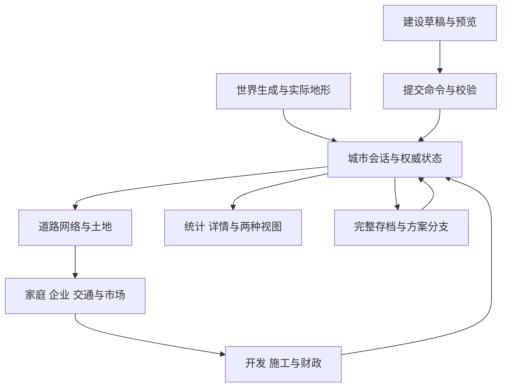

# 系统架构与状态流

## 1 架构目标

项目将世界生成、城市规则与画面表达分开。城市必须能在相同地形和输入下持续演化，允许用户暂停编辑、保存恢复及从共同初态比较方案。屏幕刷新只影响显示流畅度，不拥有人口、价格或交通统计的最终解释权。

产品要求见 [功能规则](city-simulation-requirements.md)，当前能力与简化见 [实现状态](implementation-status.md)。本页说明系统如何组织和执行；各专题解释具体玩法。

## 2 进程与职责

| 层 | 主要文件 | 职责 |
| --- | --- | --- |
| 桌面宿主 | `electron/main.cjs`、`electron/preload.cjs` | 创建窗口、启动及停止 Python 服务、受限 IPC、原生文件操作 |
| 本地服务 | `backend/server.py` | HTTP 路由、输入封装、来源和令牌检查、地形生成调度 |
| 城市会话 | `backend/city/service.py` | 世界登记、城市会话、串行操作、保存、查询与方案分支 |
| 世界生成 | `backend/terrain.py`、`hydrology.py`、`coastal.py`、`startup_land.py` | 高程、水系、海岸和启动区域 |
| 城市权威模型 | `backend/city/engine.py` | 状态、建设命令、重建、人口经济、交通分配与月度结算 |
| 规则模块 | `backend/city/` 其余模块 | 几何、开发、公共空间、设施、更新、信号和统计 |
| 界面控制 | `renderer/app.js`、`city.js`、`navigation.js` | 世界与城市工作流、工具、对象检查和用户输入 |
| 运行调度 | `renderer/simulation-driver.js` | 唯一模拟循环、速度累计、请求串行与暂停 |
| 画面表达 | `renderer/map-renderer.js`、`scene-renderer.js`、`scene-3d.js` 等 | 地图、三维及 Canvas 渲染、人车和材质 |

Electron 与浏览器预览使用相同 Python 城市服务。预览模式允许服务返回指定前端资源；桌面模式使用启动令牌和 IPC。核心玩法不需要远端服务。

## 3 数据的三种层次

### 3.1 固定世界数据

世界包含生成配置、米制范围、高程和水面网格、河流等几何以及启动区域。城市保存实际世界，恢复时不只根据种子重新生成。建设阶段不能因缩放或切换样式改变地形。

### 3.2 权威城市状态

`City.s` 保存道路、站点、线路、地块、建筑、家庭、设施、行业群组、城区、公共路径、规划走廊、更新项目、参数、资金、历史与日历。每个集合保存稳定 ID，相关对象通过 ID 引用。

建筑依附地块；家庭引用住所和工作地；线路引用站点；设施可能保留专用地块或关联站点。修改与导入需要检查这些引用，不能提交悬空住所或重复岗位占用。

### 3.3 派生网络与运行态

道路拆分后的节点和有向边、方式图、寻路结果、空间索引和部分缓存由权威状态重建。交通运行态另存路段时间和流量、旅程、显示路径及实景人车状态。保存派生运行信息可使暂停位置、等待和分配结果继续使用；路网变更后必须重新建立兼容状态。

状态中还保存随机数状态。经济随机过程和按对象稳定散列生成的外观承担不同职责；改变画面细节不能消耗经济随机序列。

## 4 从新世界到可运行城市

1. 前端提交地形参数，后端验证范围并生成米制世界。
2. 服务登记世界并返回 `worldId`；前端展示地形和启动区域。
3. 用户确认开始建设，服务以登记的实际世界创建城市并建立初始保存。
4. 城市初始化空路网、需求设置、资金、日历、随机状态和模型参数。
5. 用户绘制主要道路；提交后生成网络、临街土地及可解释的建设条件。
6. 运行时间跨月后，开发、施工、迁入就业、交通、价格和财政依序更新。

没有道路或合法地块时，城市可以保持空城。系统应解释缺少接入、没有合适土地或需求不足，而不是为展示结果直接放置人口和建筑。内置案例是另一种初始条件，不能替代空城自然生长规则。已生长案例从仓库根目录 `examples/` 读取，空路网和实景街区由代码构造；测试和视觉检查固定输入统一放在 `tests/fixtures/`，实验输出留在根目录 `experiments/`。

## 5 建设命令的执行

### 5.1 草稿与预览

前端维护尚未提交的控制点和选项，即时计算曲线轮廓，并请求后端预览地形冲突、接入及费用。预览不建设对象，不扣资金，也不改变经济随机状态。失败时保留草稿及可定位原因。

### 5.2 命令与版本

编辑通过 `City.command` 提交。命令记录类型、对象 ID 和相关属性；带有 `revision` 的请求在服务端校验版本，避免用旧画面覆盖更新后的状态。一次命令内的几何、对象引用、资金和网络改变需要一起成功或一起回滚。

### 5.3 重建与局部保持

道路编辑触发接触判断、节点拆分、有向网络及站点路径重建。地块几何按受影响道路更新，保留远处地块身份、边界和已有建筑。公共空间、特殊设施和更新预留进入占地检查，不能被重新生成的地块覆盖。

重建还更新入口、方式图、运营路径、可达性缓存及实景样本。交通设施失效应被明确标识，不能继续沿已经删除的道路运行。

### 5.4 撤销和检查点

暂停建设编辑保留最多 20 步撤销与重做。经济推进后清空编辑撤销，避免撤销画路时意外回退人口和月份。破坏性操作可在磁盘建立检查点；检查点、方案分支和编辑撤销是不同机制。

## 6 月度结算的实际次序

`City.step` 每次逐月处理，执行顺序决定哪些状态能影响本月、哪些留到下月：

1. 更新月份及当月迁入迁出计数，清空当月迁移流记录。
2. 按需求和占用补充社区道路；变化时重建网络与地块。
3. 生成基础公共空间和服务配套。
4. 推进已有城市更新项目，完成到期建筑施工。
5. 更新建筑入口和方式图。
6. 更新行业群组经营、迁入搬迁和就业匹配。
7. 生成代表日需求并分配道路、公交、区域客运和货运。
8. 根据可达、供需和环境调整土地与租金。
9. 评估自动更新并处理持续空置的后续行为。
10. 按规则生成大型自动设施和停车设施。
11. 处理建筑加层与新建项目，生成或启用街区公共空间。
12. 更新入口，识别城区，并评估 CBD 地标。
13. 结算财政、增加状态版本、汇总指标、生成事件和月度历史。
14. 每满 12 个模拟月追加年度汇总。

新项目先成为施工或预留供应，只有到期交付后才能入住或提供岗位。设施在本月哪个位置生成，决定其活动和网络效果在哪次重建与分配中体现；不能假设所有变化会在同一阶段立即达到均衡。

## 7 连续时间如何驱动月度模型

`simulation.py` 保存月内秒数、累计秒数和速度。连续推进切分到每一个真实公历月界；每跨一个月界调用一次月结算，余量保留。经济算法不由渲染帧数推进。

前端只有一个调度器，后端请求串行。高速运行保留完整日历和月结算，画面活动只保留有界样本。光照使用独立保存的时钟，详见 [时间与实景交通](simulation-and-traffic.md)。

跨月推进发生异常时，恢复城市状态、随机状态、运行态及相关编辑状态。单次请求不允许留下结算一半的城市。

## 8 子系统边界

| 模块 | 规则边界 |
| --- | --- |
| `geometry.py` | 米制采样、地形条件、道路接触、网络和临街土地 |
| `road_alignment.py`、`ramp_alignment.py`、`lane_connections.py` | 地形绕行、明确接入过渡和小路入口补接 |
| `planning.py` | 闭合街区细分、未来道路走廊及内部补路时机 |
| `blocks.py` | 小街区整体划分、公共土地和院落真实步行路径 |
| `development.py` | 区位机会、用途目标、在建供应和项目筛选 |
| `urban.py` | 自动基础配套、入口、行业群组、城区和空间统计 |
| `regional.py` | 边界铁路客运、独立货场和代表日货运 |
| `renewal.py` | 翻新、原址重建、片区分期更新及安置 |
| `auto_facilities.py`、`special_buildings.py` | 大型配套、交通建筑、停车和 CBD 地标 |
| `signals.py`、`pedestrians.py` | 实景车辆跟驰、路口保护、步行及状态保存 |
| `parameters.py`、`reporting.py` | 参数单位、默认值与统计定义 |

## 9 服务接口契约

地形通过 `/api/generate` 创建；城市接口使用 `/api/city/<action>`。调用应提交 JSON 对象，服务返回 JSON 或明确错误。主要动作包括：

| 类别 | 动作 | 作用 |
| --- | --- | --- |
| 生命周期 | `create`、`scenario`、`state`、`close` | 建立、读取、关闭城市会话 |
| 编辑 | `preview`、`command`、`special_preview`、`renewal_preview` | 预览及提交建设 |
| 时间 | `simulate`、`step`、`clock`、`traffic` | 连续推进、月步进、光照及实景样本 |
| 观察 | `inspect`、`route`、`query`、`summary` | 对象详情、旅程与空间统计 |
| 持久化 | `saves`、`save`、`load`、`import`、`export` | 存档管理和数据交换 |
| 实验方案 | `checkpoint`、`branch`、`compare` | 共同初态、独立演化与比较 |

常规响应不重复传输完整地形。服务使用锁串行执行城市操作；生成器另有锁。该结构适合本地单用户，不是多人协作服务。

## 10 工程约束与适用边界

使用 NumPy 处理地形，Shapely 处理矢量几何、裁剪与空间索引；交通连通规则由项目控制，不能将几何相交直接当成跨层连通。

寻路有缓存与分组复用，但公共交通容量仍依据实际旅程分配。路网大改需要重建全局交通，计算成本随城市规模增加。地图面积、栅格分辨率、导入数量上限和流畅可玩规模是不同概念。

本地 HTTP 服务仅绑定回环地址，桌面令牌、预览来源限制和资源白名单限制调用范围。Electron 预加载层只暴露必要能力；具体边界见当前代码，而不是把本地运行等同于无需输入校验。
