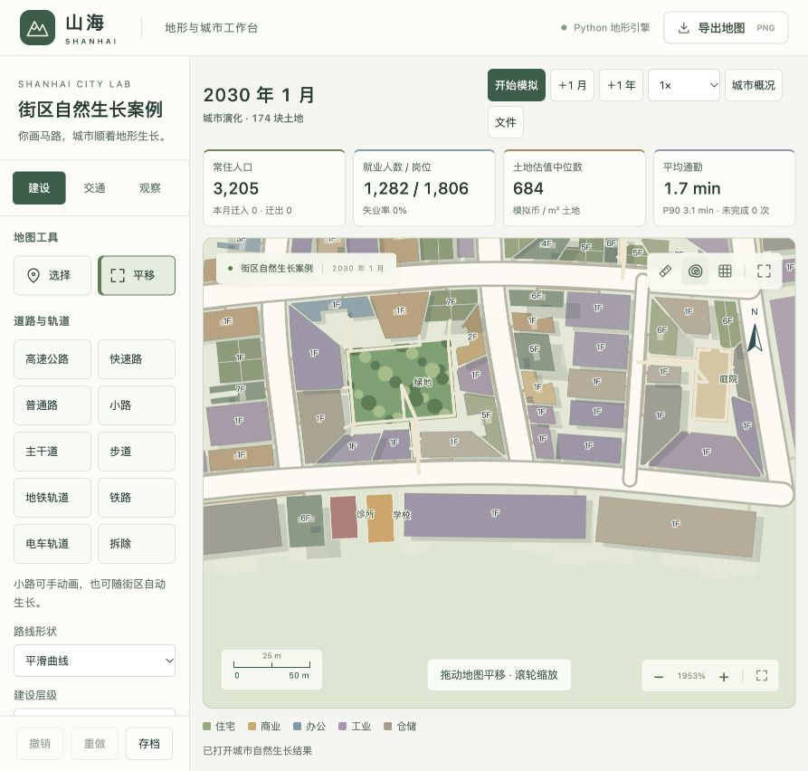

# v8 独立工业建筑轮廓修正

日期：2026-10-21；模型 `shanhai-city-8`；校准 `urban-8`。

## 问题与原因

用户截图中的厂房、仓库有不规则的台阶底边。旧算法合并最多五块深度不同的沿街用地，然后缩放整个土地轮廓作为建筑；土地边界上的接缝、错位和退进都被复制成了墙体。合并后仍保留旧入口，还会使中心—入口方向偏离实际道路方向。此前屋面方向修正仅解决条纹倾斜，没有解决建筑主体的轮廓。

## 实现

- 合并用地后，在道路上投影新地块中心，计算该位置的切线方向。入口保留其原有接入关系。
- 独立厂房、仓库在真实用地的 2 m 退让包络内选取道路朝向的矩形主体。采用固定 48 × 32 网格和矩形搜索，每个候选网格必须完整处于可建设包络内，不能跨过凹口或窄连接。这是有界近似搜索，不保证数学上的最大内接矩形。
- 覆盖率和宽深比例按稳定种子变化；包络边界不再被当作墙体直接复制。不能形成至少 100 m² 主体的用地暂不开发，不以碎条建筑凑数。
- 真实建筑占地 × 楼层继续决定建筑面积、容量与造价，剩余土地保留为退让和院地。现有入口路径仍接入真实建筑边界。本次没有额外模拟装卸车位或物流作业调度。
- 本次规则针对独立沿街的厂房、仓库。围合街区内的建筑仍使用街区布局规则，住宅、商铺的有意侧翼和庭院不被统一改成矩形。

支持 v1–v7 迁移到 v8，保存原有建筑和占用关系；载入旧城不会静默重建厂房或改变已有岗位。新规则应用于后续新建项目。首页「复杂路网案例 → 查看小街区布局案例」已经指向重新生长的 v8 案例，运行中的旧后端需要重启。

## 验证

最终集中运行 11 项相关检查，全部通过，覆盖截图原始两块合并用地的旋转、确定性、退让与有效面积，凹形/窄颈用地、真实面积和容量、旧档迁移及现有街区和步行几何。未重复运行全套地形或公共交通测试。[检查日志](experiments/city-v8-industrial-tests.log)。

使用与 v7 相同的曲线路网、种子和需求，从空路网自然生长 48 月；没有手工摆放建筑或替换单栋外观。面积变化会反馈到供给、后续选址和人口，因此城市整体统计并非必须与旧版相同。

| 指标 | v8 曲线案例 |
| --- | ---: |
| 建筑总数 / 人口 | 161 / 3,205 |
| 独立厂房、仓库 | 14 |
| 规整矩形主体 / 超出退让范围 | 14 / 0 |
| 独立厂房、仓库建筑占地占用地比例 | 57.2%–69.7% |
| 建筑重叠 / 占路 / 侵水 / 断连 | 0 / 0 / 0 / 0 |
| 街区共享通路 / 穿楼 | 72 / 0 |
| 街区内部缺少入口的建筑 | 0 |

数据：[报告](experiments/blocks-v8-final.json)、[存档](experiments/blocks-v8-final.json.gz)、[生长日志](experiments/blocks-v8-growth.log)。本案例用于验证工业形体与相关几何，没有配置公交线路，不替代大城市、CBD 或公共交通的验收。

随后移除了厂房、仓库屋面上贯穿楼体的装饰条纹。该纹理没有对应的结构或楼层含义，容易让单栋建筑看起来被切分；现在使用完整屋顶填色，保留边界、阴影和楼层文字。这是前端显示修正，旧存档重新显示即可生效，不影响建筑几何或经济统计。修改后的 `renderer/city.js` 通过语法检查。

浏览器实际打开同一新版案例并放大同一街段，确认横线已消失，未记录控制台错误：

[移除条纹前的近景](images/industrial-footprints-v8-closeup.png)、[较大范围截图](images/industrial-footprints-v8.png)。

复现：在 `terrain-atlas` 运行 `.venv/bin/python scripts/grow_blocks.py`。当前脚本输出独立的 v8 报告与存档；v7 文件保留作历史对照。
