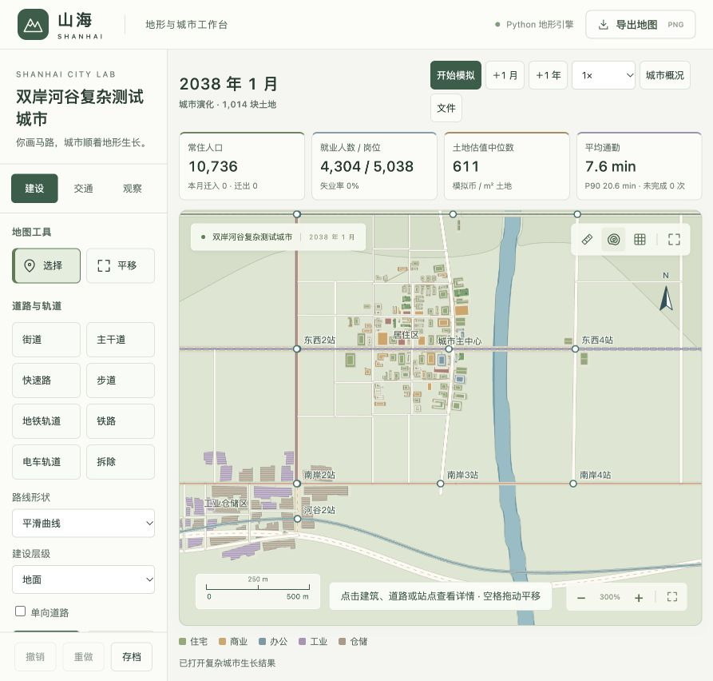
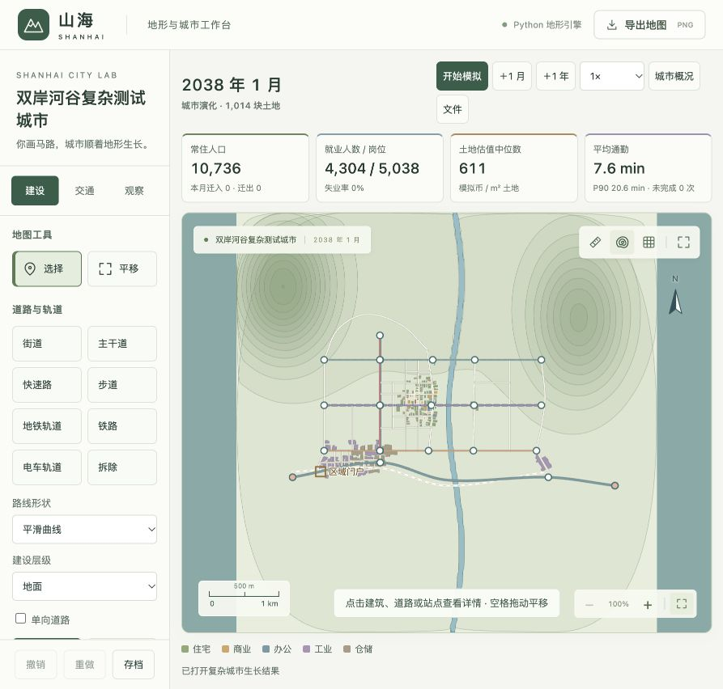
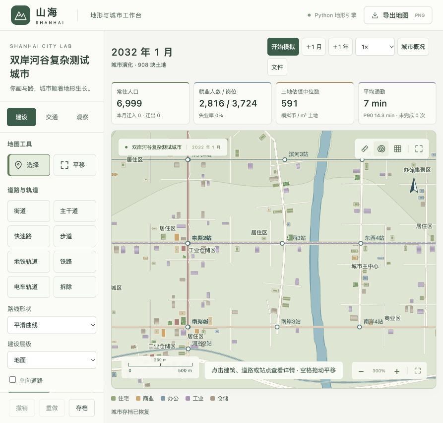
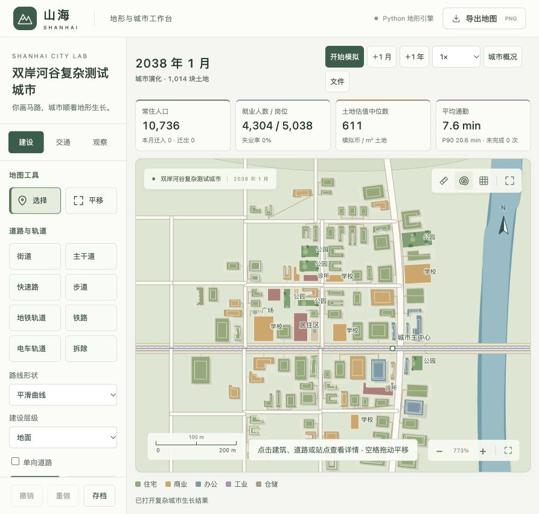

# 复杂路网自然生长与地图形态验收（v3 历史记录）

日期：2026-10-21。模型 `shanhai-city-3`，校准 `urban-3`。本记录对应用户提出的“复杂路网测试、持续优化到接近真实城市地图”，保留算法前后结果、实际画面、检查与性能边界。此处“接近真实”指街区连通、用地尺度、功能集聚、疏密和道路/地形关系；没有使用现实城市数据标定，不声称能预测现实城市。

> 后续视觉复核发现本版办公楼仍零散、学校公园过密，原 CBD 判断过于宽松。下述结果保留为历史证据，不再作为当前形态已合格的结论；首页已切换到 [v4 新案例与复核](city-clustering-validation.md)。

## 1 原案例

本版的 [144 月原始存档](experiments/valley-final.json.gz) 保留作历史对照，可通过文件导入继续推进、修改路网或运营线路。选择“从空路网开始”则保留相同地形和交通基础，所有建筑、公共设施、内部道路和居民从零生长。



完整范围 6×6 km；右岸和远郊仍有未开发地。模拟没有为了填满地图而强制放置建筑。



## 2 固定测试场景

- 种子和构造代码：[scenario.py](../city-planner/backend/city/scenario.py)。人工构造可复核的双岸河谷地形，包含弯曲河流、西北与东北山地、低地与平坦建设带。
- 22 条初始道路/轨道，包含曲线主路、三处跨河连接、不同层级的铁路和地铁；开通 5 条线路，覆盖巴士、地铁、火车和电车。
- 区域铁路设置边界客站、本地货场与边界货场，货运服务容量 2,000 吨/典型日。
- 月潜在迁入 110 户、外部岗位需求 900、增长倍率 1.6、基础开发上限 18 项；自动配套开启。
- 不画用途分区，不放置建筑，不指定 CBD。建筑、街巷、地价、居民和就业来自实际月度模拟。

`grow_valley.py` 每 12 月保存快照，并记录逐月人口、岗位、建筑、客流、价格、空置与墙钟耗时。实验在开发过程中按检查点继续，最终 72→144 月区间有独立记录；中间版本的存档保留用于解释迭代，不承诺不同算法版本逐月随机结果相同。

## 3 观察问题后实际修改的算法

第一轮观察到旧版城市沿主路散落、尽头路偏多、工厂用地和住宅接近。修正为：闭合街区递归分割、提前预留道路走廊、按父子顺序连接两侧街道；住宅、商业和办公按真实活动与交通中心性竞争开发，优先补齐既有街区。

第二轮发现工业虽已聚集，但仍是很多小地块，且一次性补路过多。加入相邻空地合并，厂房和仓库形成真实大占地；支路在冷启动后需要附近已有开发需求，失败候选冷却后重试。大地块不能吞并建筑、保护地、公园、道路或未来连接。

同时修正地块裁剪碎片与带孔面，拒绝不适合建筑的狭小残地；院落改为真实 L/U 形建筑轮廓。地图远景隐藏空地块网格，细节按缩放显示，建筑与道路按视口裁剪。屋顶和阴影表达高度，实际 footprint 始终用于面积、占用及碰撞。

最终界面验收发现并修复了快速打开城市的底图竞态：首页地形生成尚未返回时打开存档，旧请求可能随后覆盖城市的河流与山地显示。城市载入现在会作废旧请求、清理待生成队列并接管底图。重新实操快速加载、货运启停恢复和校准界面后保存最终截图；JavaScript 语法及 9 项几何检查通过。

计算侧使用反向有向最短路径共享机会场，以及家庭分组/路线复用，保留真实家庭和逐人容量分配。这个改动在 72 月同阶段把单月计算从约 11 秒降至约 5 秒。

## 4 同阶段 72 月对照

| 指标 | 旧算法 v2 | 优化后的 v3 |
| --- | ---: | ---: |
| 人口 | 6,999 | 7,444 |
| 建筑数 | 203 | 116 |
| 岗位 | 3,724 | 3,710 |
| 尽头节点 /（尽头节点＋交叉节点） | 50.5% | 8.3% |
| 建筑中心平均最近邻距离 | 88 m | 53.3 m |
| 建筑占地范围 | 340–2,166 m² | 209–11,157 m² |
| 工业＋仓储建筑 | 132 | 40 |
| 末三个月计算耗时 | 11.08 / 11.19 / 11.29 s | 4.94 / 5.24 / 5.26 s |
| 建筑重叠 / 压路 / 入水 / 失联 | 均为 0 | 均为 0 |

建筑总数减少来自厂区真实合并，而不是删去人口或岗位。尽头比例只计街道、主干道与社区支路的度 1 和度 ≥3 节点，不把长曲线采样点计为路口。最近邻距离按建筑所在土地中心计算，并非建筑净间距。

两版使用相同基础地形、道路、客运线路和增长需求。v3 同时新增了区域客货运服务，因此这是整体算法/功能版本对照，不能把所有经济差异归因于某一个参数。

原始数据：[v2 72 月](experiments/valley-v2.json)、[v3 72 月](experiments/valley-v3-72.json)。旧版结果也使用同一新版地图渲染器拍摄，便于比较空间布局。



## 5 最终 144 月自然演化

| 指标 | 实际结果 |
| --- | ---: |
| 居民 / 家庭 | 10,736 人 / 4,304 户 |
| 建筑 | 148 栋 |
| 岗位 / 实际就业 | 5,038 / 4,304 |
| 住宅 / 商业 / 办公 / 工业 / 仓储 | 74 / 16 / 7 / 34 / 17 栋 |
| 楼层 / 占地范围 | 1–24 层 / 209–11,157 m² |
| 自动社区道路 / 内部与邻里路径 | 33 条 / 265 条 |
| 公园 / 广场 / 学校 / 诊所 | 6 / 4 / 6 / 4 |
| 闭合街区 / 尽头节点比例 | 40 / 7.1% |
| 建筑中心平均最近邻距离 | 50.8 m |
| 自然识别 CBD | 12 栋建筑、1,323 岗位 |
| 平均通勤 | 7.55 min |
| 公交上车人次 | 1,292 / 典型日 |
| 区域铁路客运 / 货运 | 718 人次 / 1,260.4 吨，典型日 |
| 土地估值中位数 | 610.56 模拟币/m² 土地 |

较大厂房在货运走廊聚集，住宅围绕既有生活和交通节点填充，中心由持续办公商业就业识别；外围保留空地。地图展示了院落、低层住宅、较高办公、工业屋顶、公园、广场和实际连通街巷。该案例形成一个主中心；不把它描述为已自然长出多个副中心。



地图标注按选中对象、城区、站点和配套的优先级避让，近景不再把同一位置的多个名称叠在一起。隐藏标注的对象仍可点击查询。

几何验收扫描所有建筑和地面道路，超过 1 m² 的重叠计为冲突；记录 **0 建筑相互重叠、0 道路侵入、0 水体/建设条件冲突、0 失联建筑**。这些结果针对该存档，不是对任意地图的普遍保证。

[完整统计、逐月记录和形态检查](experiments/valley-final.json)。

## 6 性能实测与可玩规模

机器：Apple M4、16 GiB 内存、macOS 27.0.1 arm64、Python 3.14.6；浏览器视口中的地图 653×519 CSS px，DPR 2。单进程本地测试，没有声称隔离全部系统后台活动。

成熟案例从第 144 月恢复后，使用最终代码独立推进 3 月：151 栋建筑、1,014 地块、55 条道路/轨道、711 网络边、10,826 人、4,340 户、5 条线路、3 时段、2 轮分配。恢复 **0.77 s**，三个月分别 **8.07 / 8.70 / 8.33 s**，gzip 编码 **0.64 s**，峰值 **671.9 MiB**。这条性能分支不覆盖交付的 144 月存档。[原始结果](experiments/valley-performance.json)

另创建独立合成容量样本：**10,000 栋建筑、100,000 名实际居民、40,000 户、12,180 网络边、20 条公交线**。该样本直接构造对象，仅用于容量压测，不能当作自然生长城市。

| 界面实测 | FPS | 帧耗时 P95 | 输入反馈 P95 | 输入样本 |
| --- | ---: | ---: | ---: | ---: |
| 万栋总览，100% | 83.4 | 17.8 ms | 49.5 ms | 48 |
| 万栋近景，300% | 115.3 | 10.3 ms | 45.2 ms | 42 |
| 自然城市 148 栋，总览 | 120.0 | 9.2 ms | 16.9 ms | 48 |

通过界面“测量地图性能（10 秒）”并实际滚轮缩放采样；输入延迟从 DOM 事件时间戳计算到下一动画帧。测量是浏览器反馈代理，不包含物理显示器扫描和外部设备延迟。原始记录：[万栋总览](experiments/capacity-ui-overview.json)、[万栋近景](experiments/capacity-ui-close.json)、[自然城市](experiments/valley-ui-performance.json)。

十万人口样本“恢复＋一个模拟月”超过 **120 秒**，测试进程到时结束。这个规模**不作为已支持的可玩演化规模**；没有通过减少实际人数或暂停经济来伪造达标。[超时记录](experiments/capacity-10000.month-benchmark.json)

当前可验证支持范围为本报告约一万人口、百余栋多层/大型建筑的自然城市。UI 达到需求的 30 FPS / 100 ms 初始目标，月度计算仍是大城扩展的主要瓶颈。加载、模拟和长操作显示忙碌状态，地图渲染与后端计算分离。

## 7 功能回归与复现

完成所有主改动后集中运行 `npm run test:city`：**49 项 Python、9 项 JavaScript 检查通过**，Electron、前端和几何模块语法通过。随后复查修正“区域铁路客运不能被非铁路路线替代后仍计入分配”的边界，针对性运行 **16 项区域铁路、交通与模拟检查通过**。未默认重复完整地形测试。

新增案例验证连通街区与保存继续、局部道路编辑不移动远处地块、大型工业用地不重叠、客货车站分离、货运容量及断轨回退、两岸建桥可达与地价对照、真实换乘的旅程/上车口径、持续住房负担迁出、单向路反向可达性，以及校准参数确实改变步行时间。[集中检查日志](experiments/city-regression.log)、[区域交通复核日志](experiments/regional-regression.log) 随文档保留。

从项目目录执行：

```bash
# 从没有建筑的固定复杂路网开始，完整自然生长
.venv/bin/python scripts/grow_valley.py --months 144 --output ../docs/experiments/valley-replay

# 在最终存档的独立内存分支上测量三个月，不覆盖存档
.venv/bin/python scripts/benchmark_city.py --snapshot ../docs/experiments/valley-final.json.gz --months 3 --output ../docs/experiments/valley-performance-replay.json

# 重新创建合成容量样本（不属于自然生长）
.venv/bin/python scripts/stress_city.py --output ../docs/experiments/capacity-replay

# 城市相关集中检查
npm run test:city
```

早期保存的 v3 试验是在功能迭代中运行，最终代码从第 0 月重放时可能与中间检查点续跑有差异；固定最终模型、相同快照和命令的恢复一致性有专门测试。需求基线保留，逐项状态和模型抽象见 [134 项需求核对](requirements-audit.md)。
