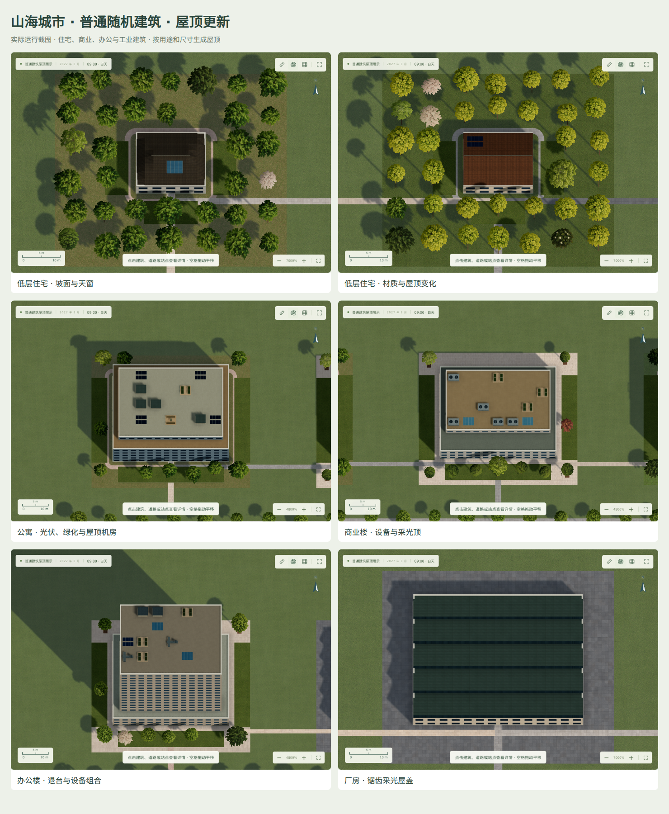

# 普通随机建筑的屋顶

住宅、商业楼、办公楼与工业厂房使用同一套确定性屋顶生成器。它根据建筑编号、用途、体块尺寸和高度生成屋顶，重新载入存档保持外观稳定，无须重建城市。

低层住宅组合四坡顶、双坡顶、单坡顶和平顶，带烟囱、采光窗或光伏。公寓和商业建筑组合机房、冷水机组、排风管、光伏、天窗、花园、廊架与休憩露台。高层办公楼可生成带天线的退台楼冠。厂房和仓库使用锯齿采光屋盖、拱形屋盖、双坡顶或设备平顶。

所有形体为实际几何。纹理变体、尺度、方向和偏移由独立种子控制。设备完整落在所属屋面内，避开上层楼体与其他模块；窄小屋面减少设备数量。每个体块最多十组设备，网格按材质批处理。

二维与三维共用楼体退台、屋顶形状和设备布局。建筑容量、原有合法占地与保存数据不变。此版本不改变特殊建筑的生成规则。

验证覆盖 180 组用途与种子组合、旋转凹形地块、布局重载稳定性、模块碰撞、有限网格坐标，以及实际界面昼夜和二维回退。展示城市使用受控地块来对照普通建筑的不同外观。

