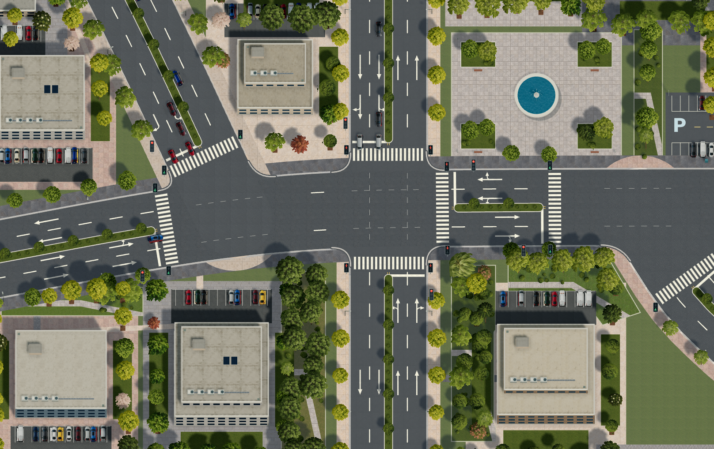
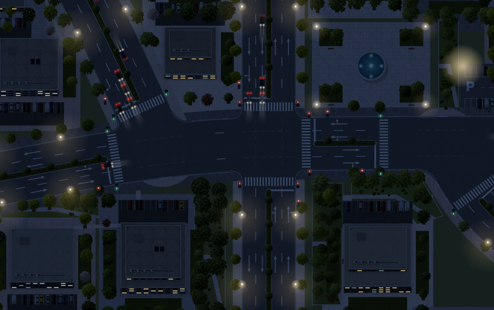

# 光照、材质与昼夜

行人现已接入实景，具备服装贴图、步态、等灯过街及存档续行。使用方式和本轮验证见 [行人实景](pedestrians.md)。

车辆灯位与材质去重复的最新调整见 [信号灯与材质优化](signals-materials.md)。

精细实景现在使用本地 Three.js 三维场景，绘制建筑体块、树冠、车辆、路灯、停车设施和喷泉。物体具有实际高度、遮挡关系、太阳投影和接触阴影。道路、地块、行人过街设施和车辆位置仍来自城市引擎，地面坐标与原有编辑、选择操作对齐。

## 打开实景街区

主菜单选择「加载地图 → 城市案例 → 打开实景街区」。已有城市可通过「城市案例」打开同一场景，切换前保存检查点。

此案例包含曲线大道、16 栋建筑、街角公园、喷泉广场及公共停车场，所有道路和建筑均为可编辑城市对象。案例采用明确标识的验证车流，便于观察车辆与行人信号灯。自动生长默认关闭，保留对照布局；可在建设设置中重新开启。

也可导入 `docs/experiments/architectural-city.json`。较大案例 `docs/experiments/lighting-materials-city.json` 包含 161 栋建筑，用于验证既有存档。



## 时间与画面品质

城市界面的「观察 → 光照与材质」提供精细实景、流畅实景、简洁地图三种品质，以及当天时刻滑块。顶部统一控制条提供开始、暂停与从实时到每秒 30 天的速度设置。精细实景使用 WebGL；设备无法创建 WebGL 上下文时自动使用 Canvas 绘制。流畅实景保留材质与昼夜效果，采用较简化的建筑和植被绘制。统计专题图保留清晰配色。

1× 时一秒现实时间对应一秒模拟时间。车辆、行人、信号阶段、昼夜与城市日历共享模拟速度。跨月自动结算城市发展，界面不再提供独立的月度演化按钮，详见 [统一模拟](unified-simulation.md)。拖动时刻会暂停并调整当天时刻，不重置车辆与交通信号阶段；重置车流也不重置日照时刻。城市时钟随存档保存，旧存档缺少时钟时从 09:00 开始。

太阳采用统一的游戏世界日周期：06:00 从东侧升起，12:00 最高，18:00 在西侧落下。太阳方位、高度、阴影方向与长度按时间变化；日出和日落平滑改变环境亮度、色温。夜间关闭太阳投影，开启路灯、建筑窗光、车辆前后灯和信号灯辉光。这一日周期不对应特定地理位置与季节的天文计算。



## 建筑、道路与绿化

建筑上部沿自身主轴拟合规则主楼和附楼，检查凹口与庭院，限制过细体块。旧存档的不规则边缘保留低层基座；无法拟合矩形的建筑使用实际轮廓拉伸。原占地、楼层、面积与容量不因渲染改变。住宅坡屋顶、厂房采光带、办公楼退台和高层塔楼采用不同体块。平屋顶具有女儿墙、出入口、空调风机、风管、排水口及天窗等设施。

路口增加沿道路边缘计算的圆角路缘，隔离带和车道线在斑马线前结束，交叉口内绘制细虚线引导线。箭头采用实心箭头和共享箭杆，只绘制引擎允许的行驶方向。车辆灯是红黄绿三灯，行人灯是站立与行走双灯，每条受控斑马线两端分别设灯，使用各自的权威灯色字段。行人放行阶段所有车辆灯均为红色。

车辆灯优先放在驶入方向对应的路口远端，每条驶入车道有一个灯头，由路缘外的灯杆和横臂支撑。丁字路口或远端空间不足时，改设在停止线前方。横臂随安装处道路方向转动，避免弯道灯杆偏入车道。车辆灯安装高度 5.8 米，行人灯高度 2.3 米；精细实景中的杆件参与遮挡与投影。

20 种树冠包含橡树、悬铃木、银杏、红枫、樱花、白桦、松柏、垂柳、棕榈和花树等形态。行道树按路段统一树种，公园和庭院混植。精细实景将透明冠幅纹理映射到有体积的树冠表面，树干与灌木也参与遮挡和投影。狭长绿地按可用宽度布置树木，树干避开步道，树冠可以遮蔽地面步道；建筑轮廓和喷泉周边保留净空。

商业与办公地块有足够空间时，增加停车位、树池和连续种植带。停车布局必须容纳在地块内，避开建筑。广场增加花池、灌木和座椅。展示细节不修改道路容量、经济状态或原存档建筑属性。

## 材质资产

4 张 4×4 图集提供 64 块表面贴图，2 张透明树冠图集提供 20 种树冠，1 张透明车辆图集提供 16 种车身外观。图集通过内置 ImageGen 生成，随项目本地加载，不依赖外部图片服务。对象标识决定材质及外观，重新加载后保持一致。

| 材质 | 变体数 |
| --- | ---: |
| 沥青 | 4 |
| 铺装 | 8 |
| 平屋面 | 8 |
| 屋瓦、金属 | 各 4 |
| 外墙、玻璃 | 12、4 |
| 草地、碎石、泥土、水面、路缘 | 各 4 |
| 白标线、黄标线磨损 | 各 4 |
| 车漆 | 12 |
| 车辆完整外观 | 16 |

纹理按世界米制尺寸铺设。沥青、草地、屋面等使用偏移、旋转和连续混合生成范围为原图 8 倍的材质场，降低小图反复平铺的特征。铺装保留规则接缝，同时改变每块石材的纹理与色差。立面、金属等具有明确方向的材质保留方向，在更大范围中变化明暗；建筑表面按位置选择不同纹理片段。纹理依然是有限尺寸的循环材质，并非无限不重复。

树冠增加个体旋转、冠幅和轻微色差。车辆按稳定散列选择图集外观及尺寸，避免相邻编号依次取同一行车型，车身、覆盖贴图和灯光位置保持一致。重新加载和移动视角不会改变这些外观。

缩小时预过滤以抑制摩尔纹。WebGL 使用标准光照材质、屋面和立面凹凸细节、各向异性过滤、柔化太阳阴影及屏幕空间环境遮蔽。树叶和车身使用透明裁切参与阴影。此实现采用实时栅格化，不使用路径追踪。

资产格位与生成提示词见 `city-planner/renderer/assets/README.md`。Three.js r180 与 SSAOPass 已打包在 `renderer/vendor/three.min.js`，MIT 许可随包提供。

## 代码与验证

- `renderer/scene-3d.js`：三维几何、材质、太阳、阴影、接触阴影、车辆和景观设施。
- `renderer/scene-renderer.js`：本地纹理、树种布置、统一时钟、Canvas 绘制与夜景。
- `renderer/surface-variation.js`：稳定材质混合、铺装接缝与车辆外观选择。
- `renderer/road-renderer.js`：道路标线、圆角路缘、隔离带范围和独立信号灯。
- `renderer/city-geometry.js`：地块内的建筑体块拟合与退台。
- `backend/city/visual_case.py`：可编辑实景街区案例。
- `backend/city/service.py`：场景入口、时钟和交通同步。

本次 38 项 JavaScript 测试和 39 项 Python 测试通过，覆盖几何、材质、植被、路口灯位、圆角路缘、终端路口浮点误差、昼夜时间、存档恢复、道路连接和既有特殊建筑。浏览器截图使用 Chromium 与 SwiftShader 实际运行生成；软件渲染结果不代表设备 GPU 帧率。

```sh
node --test tests/height-format.test.cjs tests/map-geometry.test.cjs tests/city-geometry.test.cjs tests/road-renderer.test.cjs tests/scene-renderer.test.cjs tests/special-buildings.test.cjs
python -m unittest tests.test_scene_clock tests.test_visual_case tests.test_signals tests.test_road_connections tests.test_workflow tests.test_special_buildings tests.test_terrain.ServerTests -v
```

浏览器核验记录位于 `docs/experiments/architectural-evidence.json` 与 `docs/experiments/visual-refinement-evidence.json`，记录实际引擎、纹理载入、时刻、交通状态、控制台异常及原有建筑属性比对。
