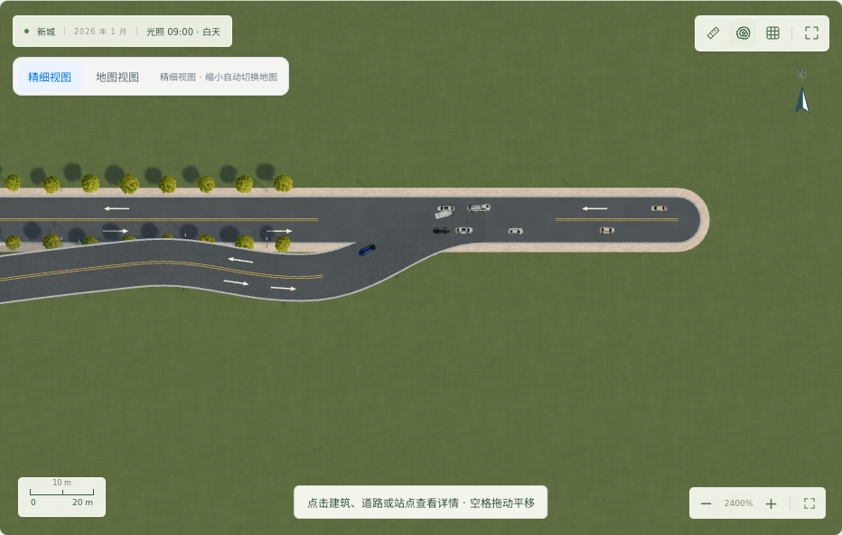
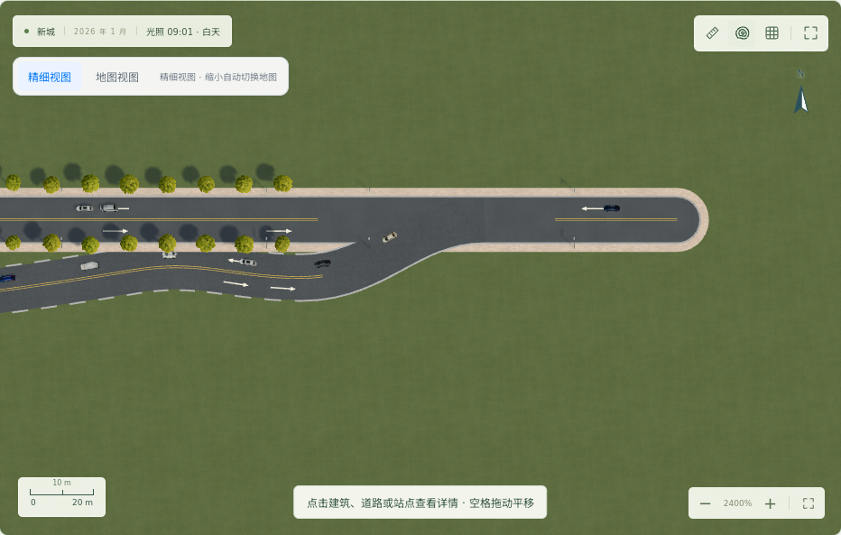

# 跨层道路连接检查与修复

## 绘制交互

点击跨层磁力吸附点后选择：

- **平行修建**：保留绘制点与层级，不建立跨层路网连接。高架显示在地面道路上方；地下道路被地面路面遮挡。
- **接入普通路**：保存明确的吸附目标。接近相同方向的中段接入会生成平滑分叉，主路保持原位；垂直接入及首尾延续保留原路线。

橙色预览与提交使用同一份后端分叉几何。分叉曲线在接入端与主路相切，空间不足 60 米时提示移动接入点。调整控制点也保留或重新询问连接选择。选择会随存档保存。

## 已修复的问题

| 问题 | 修复 |
|---|---|
| 高架末端圆头、封口路缘挡住接入口 | 根据实际共享节点合并路面，包含只有两条臂的首尾连接 |
| 曲线斜接看起来只是叠放 | 共用接入口轮廓和圆角，按实际曲线计算标线净空 |
| 宽桥接窄路时圆头突出到主路对侧 | 接入口裁切到主路对侧边缘 |
| 高架阴影固定高度、落地处突变 | 沿弧长生成连续高度曲线，桥面、标线、阴影和车辆使用同一高度 |
| 接入口的路缘、行道树遮挡通道 | 按实际连接范围避让 |
| 车辆跨层时切换成另一种模型 | 两个绘制阶段共用同一套 WebGL 车辆模型 |
| 长直段的标线偏离坡道 | 标线与路面按同样的间距采样高度 |
| 地下路标线、车辆透到地面道路上 | 地面道路遮罩与地下车辆遮挡判断 |
| 地下路铺装变成粗条纹 | 连续铺装与虚线边界分开绘制 |
| 平行道路误接入或没有分叉 | 吸附点明确选择，分叉曲线与实际路网一起生成 |

高度过渡是当前正投影视图的道路显示模型，不是独立的土木工程纵断面设计器。短路段不会为了达到固定桥高而产生高度跳变。

## 验证

实际 Chromium、WebGL / Three.js r180，未模拟画布。可重放脚本：`city-planner/scripts/check-bridge-connections.cjs`。JSON 证据：`docs/experiments/junction-fixed-playwright.json`。

| 浏览器场景 | 结果 |
|---|---|
| 直线 T 接入、首尾连接 | 双向通行 |
| 高架曲线接地面、地面曲线接高架 | 双向通行 |
| 宽桥曲线接窄路 | 双向通行 |
| 同一曲线路段两端接入 | 两个共享接入口，双向通行 |
| 未连接的上下层交叉 | 零跨层连接、零跨层车辆切换 |
| 高架选择平行修建 | 零跨层连接 |
| 地下路选择平行修建 | 零跨层连接 |
| 高架选择分叉接入 | 双向通行 |
| 地下路选择分叉接入 | 双向通行 |

共 11 个浏览器场景，同时检查精细视图、地图视图和页面错误；直线 T 接口另检查夜间显示。

自动测试：85 项 Node 测试通过；30 项道路、信号、存档和分叉专项 Python 测试通过。

全量后端首次回归运行 248 项，出现 4 项失败。桥梁经济测试仍使用旧式隐式跨层连接，已改为显式吸附目标并单独复测通过。另 3 项来自发布基线 `3a02c6e` 中未改动的城市生长/命名逻辑：

- `test_reserved_streets_make_loops_without_moving_existing_buildings`：街区数量未继续增长。
- `test_draw_and_change_every_road_grade`：旧断言要求通用道路名称，当前道路已有随机地名。
- `test_whole_block_building_and_whole_block_public_spaces`：预期的公共设施未生成。

这 3 项不属于本轮道路连接修复，仍需另行处理；未将全量回归标记为通过。

## 截图

高架分叉接入：



地下路分叉接入：



## 重放

在 `city-planner` 目录安装 Python requirements 和 Playwright 及 Chromium 后运行：

```sh
PYTHONPATH=backend node scripts/check-bridge-connections.cjs
node --test tests/*.test.cjs
PYTHONPATH=backend python -m unittest tests.test_parallel_ramps tests.test_network_intersections tests.test_road_connections tests.test_signals tests.test_city_v3.ControlledEconomyTests.test_bridge_changes_network_jobs_and_land_on_two_banks
```

可设置 `PYTHON` 和 `CHROMIUM_EXECUTABLE` 使用现有运行时；`BRIDGE_SCENARIOS` 可指定逗号分隔的场景名。脚本自行创建临时存档、启动服务、操作真实界面并清理临时数据。
