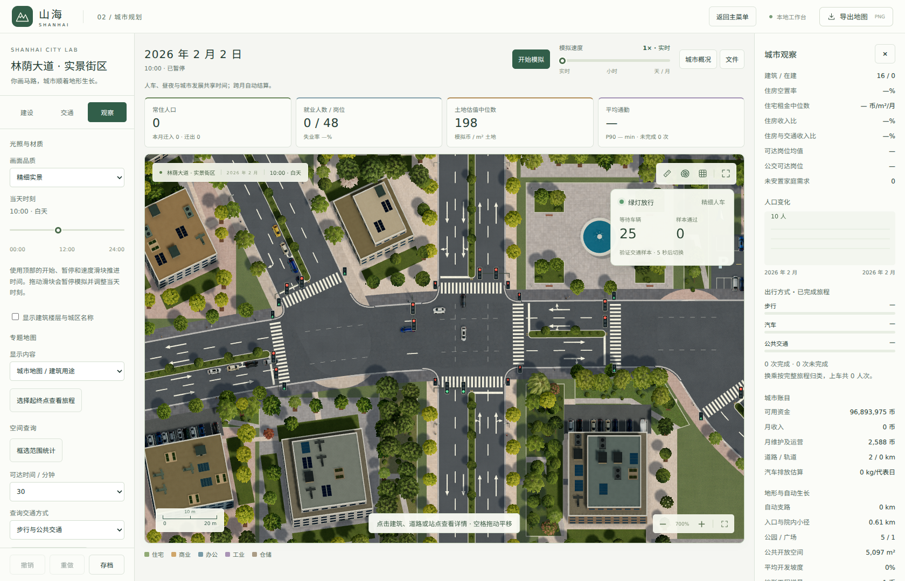
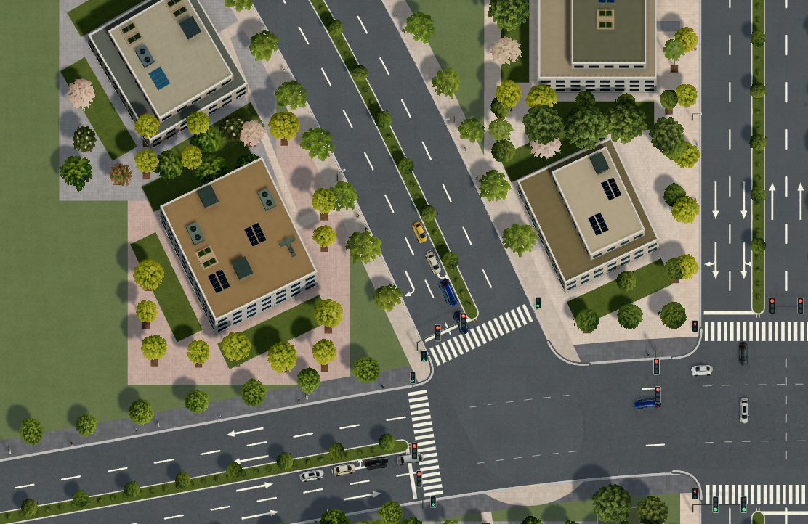
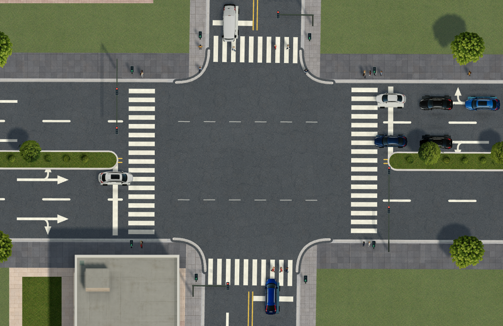
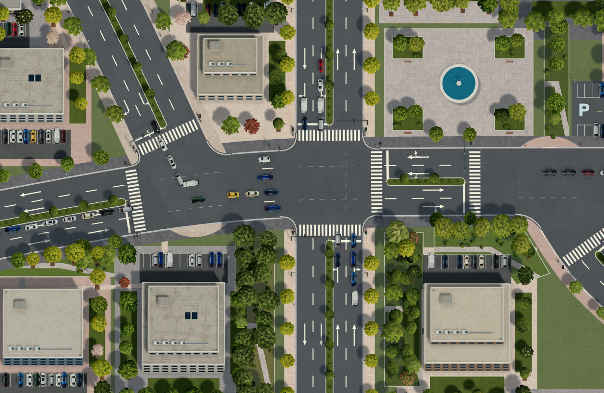
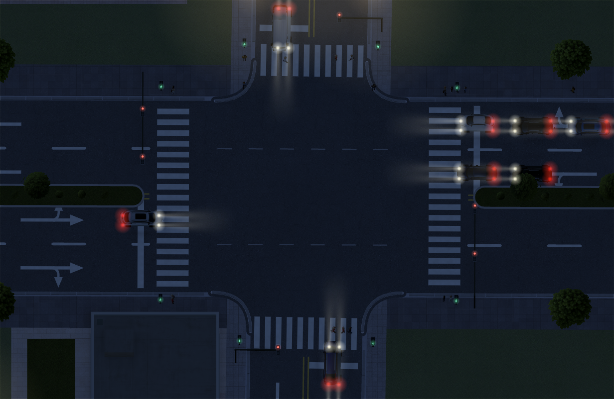

# 信号灯与材质优化

本轮修正车辆信号灯的位置和尺度，并减轻路面、铺装、绿地及建筑表面的贴图重复。

## 信号灯可读性与建筑朝向修正

街景中的车辆灯箱现在至少显示为 8 像素宽、22.4 像素高，亮灯直径至少 5.2 像素。行人灯采用独立的双灯箱和加粗人形。每米不足 4.5 像素的远景改为每个驶入方向一个状态灯；放大后恢复逐车道灯头和行人灯。行人灯杆沿斑马线微调位置，避免与车辆灯箱在斜向投影中重叠。

旧版实景街区生成器直接创建未旋转矩形，并把道路角度固定为 0，导致曲线道路两旁建筑没有随路转动。现按建筑临街位置的道路切线生成占地；普通自动生成地块也优先使用已有道路切线角度。体块、屋顶和附属停车布局从实际占地继承方向。

重新打开旧实景街区存档时，只修正仍符合原始案例形状的建筑。建筑面积、容量、地块边界和模拟时间保留；已编辑的建筑及与新增设施冲突的候选不会被移动。迁移后再次存读保持一致。





本次通过 25 项 Python 测试和 24 项 JavaScript 测试，覆盖朝向、存档迁移、用户编辑保留、越界与道路碰撞、不同道路宽度及旋转角下的灯箱净空。浏览器核验精细实景、Canvas 流畅实景、夜景、远景及实际交通运行，记录见 `experiments/signals-orientation-browser-evidence.json`。

## 信号灯

- 十字路口优先采用远端悬臂灯，每个驶入车道配置一个灯头。
- 丁字路口及远端空间不足时，灯位退到本侧停止线前方，不延伸到对面建筑地块。
- 灯杆位于路缘外，横臂按安装处的道路切线布置，支持旋转路口和弯道。
- 车辆灯安装高度 5.8 米；行人灯安装高度 2.3 米，继续使用独立的行人灯色。
- 停止线、斑马线及交通引擎的通行规则保持原有坐标和逻辑。灯头保留俯视视角下易读的正面符号。



## 贴图与外观

自然表面使用多次偏移和旋转采样，在片段间连续混合，并加入缓慢变化的色差。完整循环范围扩大至原来的 8 倍，例如沥青为 40 米。铺装单独生成规则接缝和逐块色差，避免随机旋转破坏地砖结构。具有方向的墙面、金属等采用 4 倍范围的明暗变化；建筑各表面使用不同的起始纹理位置。

树冠按位置稳定变化旋转、冠幅和颜色，车辆按编号散列选择 16 种外观及匹配尺寸。变化与模拟时间、相机位置无关，存档重新打开后保持一致。材质仍为有限尺寸循环，不代表无限独特贴图。





## 验证

31 项相关 JavaScript 测试通过，覆盖旋转路口、丁字路口、弯道灯杆净空、独立车辆和行人灯色、材质周期与接缝、外观复现、行人几何及既有建筑模型。

```sh
node --test tests/road-renderer.test.cjs tests/surface-variation.test.cjs tests/scene-renderer.test.cjs tests/pedestrian-renderer.test.cjs tests/special-buildings.test.cjs
```

浏览器使用已有城市存档和实际模拟状态核验白天、夜晚、街区全景、Canvas 流畅模式和交通运行后的灯色。记录见 `experiments/signals-materials-browser-evidence.json`。软件渲染的运行速度不代表设备 GPU 帧率。
