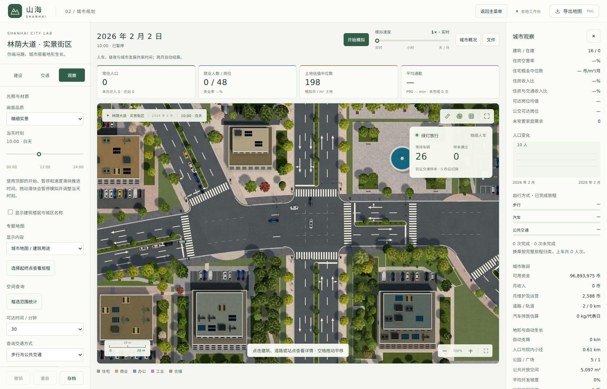

# 统一模拟

顶部只保留一套「开始模拟 / 暂停模拟」和速度滑块。车辆、行人、交通信号、日照及城市日历使用同一段推进时间；到月界时自动执行人口、企业、施工、更新、市场和财政结算。日期现在显示到日，不再需要单独启动月度演化。

| 速度档位 | 每秒现实时间对应的目标推进量 |
| --- | --- |
| 实时、5×、15×、60× | 1、5、15、60 秒 |
| 分钟与小时 | 5 分钟、1 小时、6 小时 |
| 天与月 | 1 天、7 天、30 天 |

速度可在运行中调整。暂停后保留日期、月内进度、人车位置和信号阶段。正在返回的最后一次计算仍会被接收，后续不再发起推进请求；切换城市时忽略旧城市的迟到响应。切到后台会自动暂停，恢复页面后由用户继续。实际推进速度受城市规模和计算性能限制。

## 时间与城市结算

日历从 2026 年 1 月开始，按公历月份长度计算，包含闰年二月。每跨过一个月界完整结算一次，即使一次快速推进跨越两个月，也不会漏算。未满一个月的剩余时间继续保留。月度经济仍采用原有模型，和使用相同初态直接推进相同月份的结果一致。

存档记录月内秒数、累计推进秒数和速度档位，加载后保持暂停。旧存档保留已完成月份与当天时刻，原有实景秒数作为连续运行的起点。跨月自动保存；撤销和重做建设编辑不会倒退统一时钟。

「观察」面板保留当天时刻调整，用于查看光照。拖动会暂停模拟并调整当天时刻，保留当前人车状态。该操作是设置时刻，不按跳过的小时补算交通；之后继续使用统一时间推进。

## 高速交通抽样

通常的实时至 60× 使用原有 0.1 秒跟驰和步行计算。单次需要推进超过 10 秒时，日历推进完整时长，人车仅计算末尾 3 秒的活动样本，信号阶段定位到新的时间，保留路口占用保护。城市跨月结算仍完整执行。界面会标注「高速抽样」，人车样本的等待和通过计数不代表跳过时段的全量交通统计。

切回低速后，从当前样本继续精细模拟；调整速度不会把日期或交通时钟归零。道路变化或月度重建交通分配时，会按当前路网重新生成兼容的交通样本。

## 实现与验证

- `backend/city/simulation.py`：统一时间、跨月分段、交通抽样和失败回滚。
- `renderer/simulation-driver.js`：唯一运行循环、串行请求、暂停续行和速度切换。
- `renderer/city.js`：统一控制条、日期、光照预览与状态显示。
- `tests/test_simulation.py`：月界、闰日、月度结果一致性、存档、回滚及编辑撤销。
- `tests/simulation-driver.test.cjs`：请求串行、迟到响应、速度累计、后台暂停基础行为与错误处理。

后端日历与经济、交通、行人、存档和接口测试以及前端运行循环测试通过。实际 Chromium 验证实时运行、暂停、小时加速、跨月结算、降回实时、存档恢复、在请求返回期间调整时刻，以及 1680 与 1024 像素宽度的布局。记录位于 `experiments/unified-simulation-browser-evidence.json`。

## 山地城市启动

沿街地块允许最高 45% 的地形坡度（坡度百分比，不是角度）。地形检查包含地块内部点和边界，避免狭长地块漏检；旧存档中的陡坡空地也会在开发评估时被拦截。20% 以上的坡地采用最多 3 层、占地最多 240 m² 的小体量新建筑。小型坡地住宅按局部阶梯基础估算，地形带来的额外工程成本减半；人口不足 100 人时住宅回本评估期限增加 50%，前几个项目优先评估坡地住宅。土地成本和实际工程投资仍计入项目成本。

社区公园在达到 40 人后、街角广场在达到 20 个岗位后才考虑生成；人口不足 100 人时为住宅保留最多三个较平缓的空闲地块。已建配套不自动拆除。

点击未开发地块可查看最近一次月度评估的原因，包括道路未接入、保护用地、配套占地、更新预留、极陡坡、停止发展、项目名额、需求、建筑无法布置或收益不足。没有地块时，城市观察面板提示在更平缓且远离水面的区域铺路。修改规划或发展设置后，下一次跨月评估会刷新原因。

## 新地图的启动空地

所有地貌在生成时确定一处启动区域，优先选择原有陆地中起伏较小、海拔适中的位置。常规地图保障约 600 × 600 米的平缓核心；最小地图按短边的 40% 缩小。核心外围采用平滑过渡，修改限于局部区域。粗分辨率地图额外预留采样缓冲，避免道路和地块检查读到外围陡坡。极高海平面导致缺少陆地时，局部抬升形成高于海平面的启动台地。

湖泊避开预留区域；会穿过台地及过渡带的河道段不参与生成和河床开挖，避免水系随后破坏启动空地。输出的 `startupArea` 记录中心、可用边长与海拔，同种子与参数保持可复现。空城市进入规划模式时自动定位这里；已有道路的城市仍定位到路网。此保障仅用于重新生成的地图，不修改现有存档地形。

## 持续住房需求与开工评估

未安置的迁入家庭按户累计保存：上月等待数加本月新增迁入意愿，再减去本月实际入住户数。入住仍受可用住房、可负担租金和就业吸纳能力约束。发展速度为零时停止新增意愿和迁入，保留已有队列；迁入设置为零则不产生新意愿，但允许已有队列入住。

住房需求目标包含现住家庭、累计等待家庭和基础需求。原有等待需求倍数只作用于不超过一个月新增迁入量的预留，不再重复放大整个累计队列。在新建选址时，未交付住宅、已预留的住宅更新项目和未完成的住宅扩建按 50% 计入有效供应；已交付住宅按 100% 计入。更新项目的完整容量核算仍保留，避免重复预留。每个新建住宅开工前另检查完整供应：若已覆盖目标与未来两个月迁入预留，暂缓新增住宅，避免折扣造成连续过量开工。施工期限不变。

月度项目上限只计算真正开工的建筑，选址、形状或收益评估失败不占名额。每个候选地块每月最多尝试一次；失败原因标明当前候选用途。未评估地块会区分需求未达门槛、完整住房供应已覆盖预留、名额用尽，以及货运或住宅安全选址限制。界面显示最近一次月度评估结果；城市观察面板显示等待户数、目标、已交付/含在建容量、折算供应和本月开工数。

旧存档已有的 `pendingHousing` 数值作为累计队列起点；此前月份未被保存的等待人数无法追溯补回。
